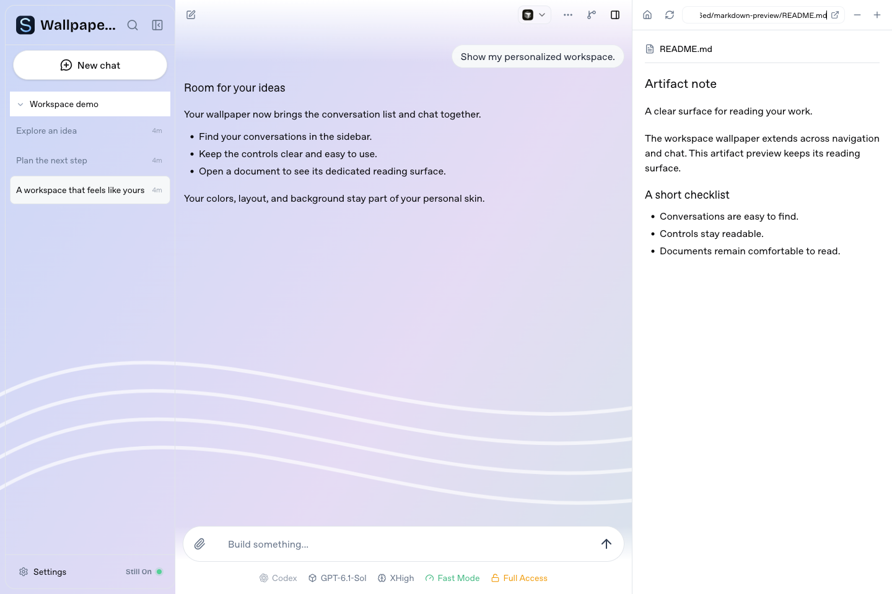
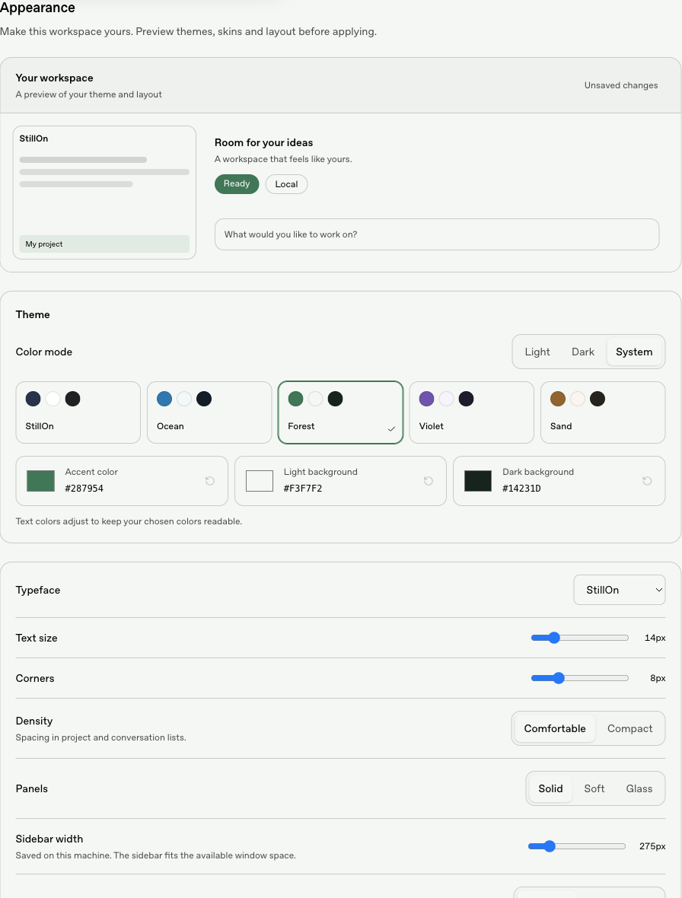

# Personal appearance

Open **Settings → Appearance** to choose a palette, color mode and custom colors.
You can also set typography, corners, list density, panel style, sidebar and
conversation widths, and a local background image. Text colors adjust for the
selected background and accent.

Background images cover the conversation sidebar and chat area. Artifact previews
keep their reading surface. With no image or zero background strength, the sidebar
uses the selected panel style.





The small workspace card shows the draft. **Preview in workspace** applies it
temporarily across the app. **Apply appearance** saves it on this machine and
updates connected clients. **Cancel**, **End preview**, leaving Appearance, or
60 seconds without confirmation restores the saved view. Changing a draft does
not save it. Restore defaults prepares a draft; apply to confirm the reset.

Sidebar dragging and keyboard resizing save its width through the same settings
channel. Existing browser-local width remains the fallback until a shared width
is set. Desktop width is capped to 35% of the current window so narrow settings
views remain usable. Resizing is paused during a temporary appearance preview and safe mode.

## Portable skins and storage

**Export applied skin** downloads `stillon-skin.json`, including any background
image. It contains appearance preferences only, with no project history, provider
settings, machine paths or credentials. **Import skin** prepares the imported
appearance for preview; apply to activate it. Skin color mode uses the destination
machine's existing Light/Dark/System choice; the palette includes both variants.

Default storage:

- `~/.stillon/data/settings.json`: versioned appearance preferences and color mode.
- `~/.stillon/data/customizations/appearance/assets/<sha256>.png|jpg|webp`: local images.
- `~/.stillon/data/customizations/appearance/skins/<sha256>.json`: imported packages.

An instance configured with another data directory stores these paths relative to
that directory. Files are outside the immutable runtime, so updates and native
uninstall keep them. Failed-update rollback restores the original settings and
assets; failed-version changes remain in the updater's quarantine. Changing or
resetting a skin does not delete personal packages or images.

API 1 uses declarative values; supported shapes and component aliases are the
compatibility contract. File preservation and future rendering compatibility are
separate. Unsupported package API versions are retained, inactive, and reported
without changing the applied appearance. Invalid packages do not alter settings.

## Skin API 1

```json
{
  "format": "stillon-skin",
  "themeApi": 1,
  "uiApi": 1,
  "name": "Quiet Forest",
  "appearance": {
    "schemaVersion": 1,
    "palette": "forest",
    "accent": "#287954",
    "lightBackground": null,
    "darkBackground": null,
    "font": "system",
    "fontSize": 14,
    "cornerRadius": 12,
    "density": "comfortable",
    "surface": "soft",
    "sidebarWidth": 300,
    "chatWidth": "wide",
    "backgroundOpacity": 0.12
  }
}
```

The optional `background` is `{ "mimeType": "image/png", "base64": "..." }`.
Skin files are limited to 3 MB. Backgrounds must be PNG, JPEG or still WebP,
2 MB or smaller, at most 4096 px per side and 12 megapixels. Animated PNG/WebP,
SVG, arbitrary CSS/JS, paths and remote URLs are not part of this format.
Uploaded images use content-derived names and authenticated routes. Import is
bounded before parsing; image signatures/dimensions and declared MIME are checked.

| Preference | Values / bounds |
| --- | --- |
| `palette` | `default`, `ocean`, `forest`, `violet`, `sand` |
| `accent`, `lightBackground`, `darkBackground` | `#rrggbb` or `null` to use palette |
| `font` | `body`, `system`, `mono` |
| `fontSize`, `cornerRadius` | 13–18 px, 4–20 px |
| `density` | `comfortable`, `compact` |
| `surface` | `solid`, `soft`, `glass` |
| `sidebarWidth` | 220–520 px, or `null` for existing browser width |
| `chatWidth` | `comfortable`, `wide`, `full` |
| `backgroundOpacity` | 0–0.4 |

Partial manifests use defaults for omitted preferences. Export includes a complete
normalized preference set. Server-assigned `backgroundAsset` and the active
`skinName` are not portable preference fields; the package background/name supply
those values. Schema changes require an explicit API version and migration.

## Public UI hooks

`data-stillon-part` names are `workspace`, `sidebar`, `chat`, `chat-column`,
`chat-row`, `composer`, `composer-column`, and `appearance-settings`.
The implementation maps palette primitives to existing semantic tokens such as
`--background`, `--foreground`, `--primary`, `--border`, `--radius`, then to
`--stillon-font`, `--stillon-font-size`, `--stillon-row-height`,
`--stillon-row-padding`, `--stillon-chat-width`, `--stillon-composer-width`,
`--stillon-surface`, `--stillon-surface-shadow`, `--stillon-wallpaper`, and
`--stillon-wallpaper-opacity`. Skins set documented preference values; the host
owns selectors and CSS compilation. Mobile keeps its full-screen sidebar.

## Recovery

Open `/settings/appearance?safe-mode=1` directly. Safe mode bypasses personal
theme tokens, image backgrounds, typography and layout before application. It
stays enabled across in-app navigation. Personal files and saved preferences
remain intact. Restore defaults and apply, or edit the preferences, then use
**Return to your saved appearance** to leave safe mode through a fresh page load.

Pet work and executable UI extensions are outside this phase.
