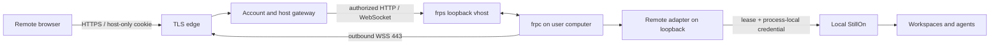

# StillOn Connect (development preview)

Connect lets a browser reach the user's own continuously running computer.
Local use remains accountless on `127.0.0.1`. Files, workspaces and agent processes
stay on that computer. The managed gateway terminates TLS and can see traffic;
this release does not claim end-to-end encryption or that model providers never
receive files used in agent requests.

This is a development preview, not a customer release. Independent installation,
public-network/mobile reliability, platform certification and a 12-hour soak are
separate gates. Billing, custom domains, teams and file synchronization are deferred.

## User flow

1. On the computer: Settings → Remote access → Link email → open verification page.
   Enter the email and six-digit code, then **Verify and link computer**. The OTP is tied to
   this enrollment; an existing account cookie cannot approve it by itself.
2. Elsewhere: sign in at the configured Connect URL. One computer opens directly.
   With several, the portal retains the selected computer or picks the first
   registered one. Offline selection stays fixed; there is no silent failover.
3. Switch computers in remote Settings → Remote access. Each tab uses its own host
   origin, so switching one tab never retargets another.
4. **Logout** revokes the current central session and all host sessions derived
   from it. Independently signed-in browsers continue. Local tasks and binding
   remain. Fresh OTP authentication replaces the browser's previous session
   family, including an explicit account switch.
5. Pause preserves binding. Unbind retires the host URL and preserves files/tasks.
   Offline unbind closes the local adapter immediately and retries cloud
   revocation when networking recovers. Rebinding creates a new host ID.

## Architecture and authorization



- Central origin: `https://connect.stillon.example`; computers:
  `https://h-<32 lowercase hex characters>.connect.stillon.example`. A host URL
  is a locator, never a grant. DNS and TLS must cover central and wildcard names.
- Ed25519 device keys are generated locally. One-use cloud challenges last 60 s
  and sign the subject/action/payload. Enrollment lasts 10 min and can be claimed
  only by its original device key. Duplicate active device identities are fenced.
- Host handoff uses a host-only PKCE verifier, state, a single-use 30 s code and
  an owner/host/epoch/parent-bound session. Cookies are HttpOnly, SameSite=Lax,
  Secure/`__Host-` on HTTPS, and have no parent-domain scope. No bearer token is
  returned to browser JavaScript. Fresh OTP is required for binding and remote
  unbinding.
- The gateway rechecks authorization on requests, frames and stream pulls.
  Signed adapter leases last at most 45 s; signed device heartbeats renew them
  every 15 s. Missing renewal fails closed. Normal revocation closes gateway
  streams immediately; the adapter follows within its lease. Online status
  requires both device heartbeat and registered tunnel activity within 45 s.
- Accountless local ingress still checks Host/Origin and WebSocket origin.
  A loopback peer is not a remote credential. The separate adapter adds a random
  process-local credential. Remote requests cannot invoke binding controls,
  managed updates, external-app opening or arbitrary localhost preview proxies.
- Remote file HTML/SVG API responses carry a response-level sandbox without
  `allow-same-origin`. [Dynamic HTTP previews](connect-dynamic-previews.md) use
  isolated, computer/port-scoped origins with their own authorization and
  support same-origin APIs and WebSocket hot updates. Static reports retain
  read-only folder capabilities. The chat header retains the browser globe.
- Remote drafts, terminal layouts, sidebar snapshots and answer contents are
  not persisted in browser storage. Focus, reconnect and back/forward restores
  use a non-dismissible modal privacy shield while checking the session. A
  successful check retains the mounted workspace, draft and scroll position;
  expiry or an unavailable host unmounts private content. Pagehide applies the
  shield synchronously before back/forward-cache restoration.
- Remote commands never replay automatically. Timestamped operation IDs have a
  24 h window, scoped to owner and this computer. Durable receipts return the
  original response for matching duplicates and reject changed bodies.
  Unfinished receipts become `RESULT_UNKNOWN` after restart. This is at-most-once
  dispatch, not an exactly-once transaction with agent/provider side effects.

## Transport decision and limits

frp **0.71.1**, Apache-2.0, owns framing/multiplexing. Its HTTP plugin hooks
`Login`, `NewProxy`, `Ping`, `NewWorkConn` enforce per-device credentials and one
exact HTTP vhost. Arbitrary TCP/UDP, domains and port allocation are rejected.
There is no shared client secret. Control, plugin and vhost bind only loopback.

The client uses public WSS443. frp does not verify server certificates by default
without a CA file; the connector always supplies Bun's public roots and server
name. Plain WebSocket is allowed only for loopback development. See the
[upstream TLS implementation](https://github.com/fatedier/frp/blob/v0.71.1/pkg/transport/tls.go)
and [plugin contract](https://gofrp.org/en/docs/features/common/server-plugin/).
Desktop builds seal an independent component requirement with pinned archive and
executable SHA-256 checksums. First-time setup prepares it in a per-user shared
cache; subsequent application versions verify and reuse matching bytes. A cold
start under an older updater may make one asynchronous preparation attempt, but
the reconnect loop never downloads executables. Failed or quarantined attempts
require explicit repair from local Remote access settings. See
[component packaging](desktop-distribution.md#independent-connect-component).
Device keys and
temporary transport credentials use 0600 files; Windows ACL handling requires
real-machine acceptance.

Uploads/downloads stream through the gateway. Unmodified Content-Length is
preserved. Framing headers, cookies, authorization and spoofable internal/
forwarding headers are stripped and rebuilt. Limits: 100 MiB uploaded files,
110 MiB request envelope, 1 MiB WebSocket frames, 2 MiB per-stream backpressure,
32 streams per owner, 256 per process. These are protective bounds, not measured
capacity. Example service limits are 512 MiB for Connect and 256 MiB for frps.

Bun 1.3.14 has a reproduced [server-side close shutdown issue](https://github.com/oven-sh/bun/issues/36223).
Relay streams are explicitly terminated and listener shutdown is bounded; owned
request tasks drain before databases close. Retest this when changing Bun.

## Source ownership and verification

The local connector/adapter and shared protocol remain in this public
repository. The officially hosted account service, login portal, cloud
packaging, deployment/recovery tooling and full integration suite live in a
separate private repository. See [repository layout](repository-layout.md).

Public development is independent:

```sh
bun install --frozen-lockfile
bun run check
bun run test
bun run audit
```

For desktop packaging, set only the public `STILLON_CONNECT_ORIGIN` when running
`bun run build:desktop --runtime-only`. The package includes the device-side
frpc requirement and public `runtime/connect.json`; it does not include
cloud server source, keys or databases. Existing saved bindings and device keys
are not changed by the repository split.

Maintainers run the private suite against a pinned public revision and the
pre-split client baseline. It exercises two isolated real StillOn instances,
synthetic email accounts, enrollment, HTTP/WebSocket forwarding, file integrity,
previews, cross-entry persistence, account isolation and revocation over real
frps/frpc tunnels. Public preview scripts accept an explicit test fixture module
from that suite. No public build or CI job needs private credentials.

Managed-service operations, mail delivery, TLS, backups and recovery remain the
service operator's responsibility. The source split alone does not deploy code
or migrate account state. Public-network/platform acceptance remains separate
from local integration evidence.

## Signed-in browsers

Settings → Remote access lists the linked account's valid browser logins, with
browser/platform, remaining validity and last use. One account login counts
once across tabs and computers. Separate profiles or independent logins count
separately. In a remote workspace, **This device** marks the calling browser's
login; the local app does not infer a current browser from the computer or IP.

**Sign out** revokes that account session and every computer/preview session
created from it, closing their active remote streams. Other browser logins,
computer bindings and running local tasks remain. Signing out the current
browser returns it to the logout page. The existing email login and 30-day
absolute expiry policy are unchanged.

Local management uses a fresh, signed device challenge for the bound account.
Remote management requires the host session and same-origin request. Both
paths check account ownership; neither returns session bearer tokens or accepts
a caller-selected account. Local management remains available while remote
access is paused, provided the account service is reachable.

Last use is recorded by the account service on sign-in, authenticated workspace
requests and browser commands, with writes coalesced to a minute. Device
heartbeats, WebSocket pings, session-status checks, sidebar bootstrap polling
and browser-list polling do not advance it. Existing logins show **Not recorded yet** until activity has
been observed after upgrading. This timestamp describes observed use, not
continuous online presence. Browser/platform names are descriptive user-agent
labels, not trusted device identities.

Client and account service updates are both needed for this feature. An older
service or a failed request displays an unavailable/error state instead of
claiming that zero browsers are signed in. Focus and periodic visible-page
refreshes reconcile changes made through another entry.

Focused browser-session integration lives in the private service repository.
It exercises count/current markers, cross-entry reads and revocations, durable
usage updates, multiple-computer stream closure, self-revocation and preserved
bindings. These checks continue to use the real account gateway, tunnels,
adapters and local servers.

### Large messages and slow connections

The gateway and host adapter accept WebSocket messages up to 5 MiB each.
Repeated messages within that ceiling are allowed; there is no large-message
counter. Generic preview sockets preserve text/binary frames and subprotocols.
Temporary congestion queues frames in order. A connection closes after 30
seconds without send progress, or if actual pending data exceeds 64 MiB.

New application browsers request `stillonTransport=1` on `/ws`. Supporting hosts
announce `~stillon/ready/1` and split large protocol-1 JSON envelopes into small
Unicode-safe frames, with four frames in flight and receiver acknowledgements.
Commands execute only after complete assembly, keeping existing operation IDs
and remote command receipts. Disconnecting discards partial transfers; it does
not replay commands. Old browsers receive ordinary JSON, and new browsers use
ordinary JSON with old hosts. Chunked messages also fit through the original
1 MiB Connect relays. HTTP file transfers keep their separate limits.

Raising the native frame ceiling requires upgrading both the gateway and host
adapter. Chunking additionally requires the new application browser and host.
Updating only the gateway cannot remove an old installed adapter's 1 MiB limit.

## Automatic outbound routing

Connect tries direct access first. If DNS, a connection or a network timeout
prevents access, it falls back to an inherited HTTP CONNECT proxy. Device API
requests and frpc always share the selected route, including reconnects. There
is no routing configuration UI; model/provider network settings are separate.
System VPN routing continues to be handled by the operating system.

For HTTPS authorities, proxy precedence is `https_proxy`, then `http_proxy`,
then `all_proxy`; each lowercase variable takes precedence over its uppercase
variant. HTTP test authorities skip `https_proxy`. `no_proxy` (or `NO_PROXY`)
prevents fallback for matching API or tunnel authorities. Entries support `*`,
host/domain suffixes, optional ports and bracketed IPv6 addresses. The shared
proxy scheme is `http://` (with optional credentials); unsupported or malformed
proxy values are reported in diagnostics without disclosing their contents.
Only the frpc child receives a sanitized proxy environment. The application and
provider environments are retained.

API requests have a 10-second deadline. An API response without an online tunnel
does not establish connectivity: after 30 seconds, Connect tears down the stuck
tunnel and retries using the other available route, with 5–60-second backoff.
Certificate verification, authentication and application errors do not trigger
proxy fallback. Signed operations are not automatically replayed after a lost
response. Device identity and email binding survive network recovery.

While using a proxy, Connect probes direct HTTPS/HTTP health at most every five
minutes when there are no active relayed leases. A successful idle probe starts
a new direct tunnel; if that tunnel cannot connect, normal fallback applies.
Active streams are never moved by this periodic probe. Local copied diagnostics
include the selected route and the last API/tunnel failure category, without
proxy URLs, credentials or raw transport logs.
