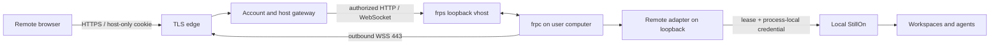

# StillOn Connect (development preview)

Connect lets a browser reach the user's own continuously running computer.
Local use remains accountless on `127.0.0.1`. Files, workspaces and agent processes
stay on that computer. The managed gateway terminates TLS and can see traffic;
this release does not claim end-to-end encryption or that model providers never
receive files used in agent requests.

This is a development preview, not a customer release. Independent installation,
public-network/mobile reliability, platform certification and a 12-hour soak are
separate gates. Billing, custom domains, teams and file synchronization are deferred.

## User flow

1. On the computer: Settings → Remote access → Link email → open verification page.
   Enter the email and six-digit code, then **Verify and link computer**. The OTP is tied to
   this enrollment; an existing account cookie cannot approve it by itself.
2. Elsewhere: sign in at the configured Connect URL. One computer opens directly.
   With several, the portal retains the selected computer or picks the first
   registered one. Offline selection stays fixed; there is no silent failover.
3. Switch computers in remote Settings → Remote access. Each tab uses its own host
   origin, so switching one tab never retargets another.
4. **Logout** revokes the current central session and all host sessions derived
   from it. Independently signed-in browsers continue. Local tasks and binding
   remain. Fresh OTP authentication replaces the browser's previous session
   family, including an explicit account switch.
5. Pause preserves binding. Unbind retires the host URL and preserves files/tasks.
   Offline unbind closes the local adapter immediately and retries cloud
   revocation when networking recovers. Rebinding creates a new host ID.

## Architecture and authorization



- Central origin: `https://connect.stillon.example`; computers:
  `https://h-<32 lowercase hex characters>.connect.stillon.example`. A host URL
  is a locator, never a grant. DNS and TLS must cover central and wildcard names.
- Ed25519 device keys are generated locally. One-use cloud challenges last 60 s
  and sign the subject/action/payload. Enrollment lasts 10 min and can be claimed
  only by its original device key. Duplicate active device identities are fenced.
- Host handoff uses a host-only PKCE verifier, state, a single-use 30 s code and
  an owner/host/epoch/parent-bound session. Cookies are HttpOnly, SameSite=Lax,
  Secure/`__Host-` on HTTPS, and have no parent-domain scope. No bearer token is
  returned to browser JavaScript. Fresh OTP is required for binding and remote
  unbinding.
- The gateway rechecks authorization on requests, frames and stream pulls.
  Signed adapter leases last at most 45 s; signed device heartbeats renew them
  every 15 s. Missing renewal fails closed. Normal revocation closes gateway
  streams immediately; the adapter follows within its lease. Online status
  requires both device heartbeat and registered tunnel activity within 45 s.
- Accountless local ingress still checks Host/Origin and WebSocket origin.
  A loopback peer is not a remote credential. The separate adapter adds a random
  process-local credential. Remote requests cannot invoke binding controls,
  managed updates, external-app opening or arbitrary localhost preview proxies.
- Remote file HTML/SVG API responses carry a response-level sandbox without
  `allow-same-origin`. [Dynamic HTTP previews](connect-dynamic-previews.md) use
  isolated, computer/port-scoped origins with their own authorization and
  support same-origin APIs and WebSocket hot updates. Static reports retain
  read-only folder capabilities. The chat header retains the browser globe.
- Remote drafts, terminal layouts, sidebar snapshots and answer contents are
  not persisted in browser storage. Focus, reconnect and back/forward restores
  use a non-dismissible modal privacy shield while checking the session. A
  successful check retains the mounted workspace, draft and scroll position;
  expiry or an unavailable host unmounts private content. Pagehide applies the
  shield synchronously before back/forward-cache restoration.
- Remote commands never replay automatically. Timestamped operation IDs have a
  24 h window, scoped to owner and this computer. Durable receipts return the
  original response for matching duplicates and reject changed bodies.
  Unfinished receipts become `RESULT_UNKNOWN` after restart. This is at-most-once
  dispatch, not an exactly-once transaction with agent/provider side effects.

## Transport decision and limits

frp **0.71.1**, Apache-2.0, owns framing/multiplexing. Its HTTP plugin hooks
`Login`, `NewProxy`, `Ping`, `NewWorkConn` enforce per-device credentials and one
exact HTTP vhost. Arbitrary TCP/UDP, domains and port allocation are rejected.
There is no shared client secret. Control, plugin and vhost bind only loopback.

The client uses public WSS443. frp does not verify server certificates by default
without a CA file; the connector always supplies Bun's public roots and server
name. Plain WebSocket is allowed only for loopback development. See the
[upstream TLS implementation](https://github.com/fatedier/frp/blob/v0.71.1/pkg/transport/tls.go)
and [plugin contract](https://gofrp.org/en/docs/features/common/server-plugin/).
Build-time release downloads have pinned SHA-256 checksums. Startup verifies the
installed binary manifest and never downloads an executable. Device keys and
temporary transport credentials use 0600 files; Windows ACL handling requires
real-machine acceptance.

Uploads/downloads stream through the gateway. Unmodified Content-Length is
preserved. Framing headers, cookies, authorization and spoofable internal/
forwarding headers are stripped and rebuilt. Limits: 100 MiB uploaded files,
110 MiB request envelope, 1 MiB WebSocket frames, 2 MiB per-stream backpressure,
32 streams per owner, 256 per process. These are protective bounds, not measured
capacity. Example service limits are 512 MiB for Connect and 256 MiB for frps.

Bun 1.3.14 has a reproduced [server-side close shutdown issue](https://github.com/oven-sh/bun/issues/36223).
Relay streams are explicitly terminated and listener shutdown is bounded; owned
request tasks drain before databases close. Retest this when changing Bun.

## Reproduce and package

```sh
bun install --frozen-lockfile
bun run check
bun run test
bun run prepare:connect-runtime --server
bun scripts/test-connect-transport.ts
```

The last command uses two isolated real StillOn instances, accounts, frps/frpc
and a fake sender. It verifies enrollment, authorization, HTTP/WS, avatar saves
through both local and Connect entries with cross-entry reloads and persistence,
rejected avatar writes and account isolation, 1/20/100 MiB file integrity,
Range/HEAD/Unicode names, over-limit rejection, receipts, lease renewal, Logout
and pause/resume/unbind. It does not call
an agent model or send real email. `bun scripts/preview-connect.ts` provides the
same isolation for browser QA; synthetic mail is in ignored test artifacts.

Set only the public `STILLON_CONNECT_ORIGIN` when running
`bun run build:desktop --runtime-only`. The package includes frpc, its license,
manifest and public `runtime/connect.json`; never cloud keys or databases.
Development source runs use the same origin variable after preparing transport.
The Desktop installers workflow accepts a `connect-origin` input. Pull-request
artifacts include frpc with an intentionally invalid example origin to test
packaging on every architecture; they need a real configured origin before use.

`bun scripts/build-connect.ts` assembles a separate cloud directory after
`bun run build:connect`. Default target is `linux_amd64`; `--target=linux_arm64`
selects that architecture. Install a verified supported Bun runtime separately
at the unit's configured path. The assembled dependency lock and manifest seal
that build. Verify its code and dependencies with
`bun scripts/test-connect-transport.ts --cloud-package=dist/connect-service`.
The loopback fixture uses the native frp binary; actual Linux startup still needs
a Linux acceptance run. The cloud package contains `connect.env.example` and
the recovery script; keep the real environment outside its release directory.

## Deployment and recovery

Pending enrollment can be cancelled from the local settings page. Cancellation
is signed by the enrolling device; a lost claim response does not leave an
active orphan host. If the cloud is unreachable, the local channel stays closed
and the saved cancellation retries after restart before a new binding can begin.

The local/remote settings page offers **Copy connection diagnostics**. Local
reports include version, protocol, state, bounded error codes and the last cloud
response time. Remote reports contain browser connection status only. Neither
includes device keys, email, host IDs, paths, URLs or file contents; the local
diagnostic endpoint is denied through the remote gateway.

`/health` reports process liveness. `/ready` returns 200 only when the account,
budget and host databases can be read and the frps HTTP listener responds; it
returns 503 otherwise. Probes are coalesced/cached for five seconds, with a
1.5-second dependency deadline and no redirects. This does not prove outbound
mail delivery, disk write capacity, TLS validity or connectivity to every host.
Operations should poll both endpoints and alert after repeated readiness
failures, separately monitor certificate expiry, disk/RAM and mail failures,
and rehearse those alerts before inviting users. Probe the central authority,
not a host origin; preserve its Host header when checking loopback directly.

1. Create a dedicated unprivileged account, `/var/lib/stillon-connect` and a
   root-managed private environment file. Configure [mail](connect-email-login.md).
   Preserve existing apps, personal Feishu ingress, VPN and SSH.
2. Provision central/wildcard DNS and a certificate covering both names via
   DNS-01. Keep DNS credentials in operations and verify certificate renewal.
3. Review `packaging/connect/`. Only public TLS443 is exposed. The central
   `/~!frp` WebSocket path goes to control3222; other central/host traffic goes
   to the authorized gateway3220. Plugin3221 and vhost3223 are never public.
4. A shared SNI dispatcher needs a separate narrow mapping and listener. Preserve
   actual client IP using PROXY protocol or an equivalent trusted route; otherwise
   login IP budgets collapse to one dispatcher. Overwrite X-Real-IP, avoid query/
   body logging, disable private caching and apply edge connection/rate limits.
5. Back up live configuration, validate candidates, activate atomically and check
   the existing services plus real external TLS, email and cross-account denial.

SQLite is single-instance with WAL; do not share its data directory between
gateway processes. Stop the service and checkpoint all databases before backup.
Keep private backups outside public assets. To restore a checkpointed backup:

```sh
bun scripts/restore-connect.ts /private/backup /private/new-data-dir
```

The tool refuses an existing destination, retains accounts, retires all old
devices/sessions and omits old OTP receipts/signing keys. Supply a new account
secret and bind computers again. This prevents a pre-revocation backup from
resurrecting access. Original computer files are untouched. Roll back code/config
without rolling back current revocation state. If schema compatibility is unknown,
pause remote access and use conservative restore instead of replaying old state.

Independent installation/reboot, macOS arm64/Windows, mobile/cellular access,
real mail-provider matrix, TLS renewal, infrastructure rollback and a 12-hour
soak remain required release gates.

## Signed-in browsers

Settings → Remote access lists the linked account's valid browser logins, with
browser/platform, remaining validity and last use. One account login counts
once across tabs and computers. Separate profiles or independent logins count
separately. In a remote workspace, **This device** marks the calling browser's
login; the local app does not infer a current browser from the computer or IP.

**Sign out** revokes that account session and every computer/preview session
created from it, closing their active remote streams. Other browser logins,
computer bindings and running local tasks remain. Signing out the current
browser returns it to the logout page. The existing email login and 30-day
absolute expiry policy are unchanged.

Local management uses a fresh, signed device challenge for the bound account.
Remote management requires the host session and same-origin request. Both
paths check account ownership; neither returns session bearer tokens or accepts
a caller-selected account. Local management remains available while remote
access is paused, provided the account service is reachable.

Last use is recorded by the account service on sign-in, authenticated workspace
requests and browser commands, with writes coalesced to a minute. Device
heartbeats, WebSocket pings, session-status checks, sidebar bootstrap polling
and browser-list polling do not advance it. Existing logins show **Not recorded yet** until activity has
been observed after upgrading. This timestamp describes observed use, not
continuous online presence. Browser/platform names are descriptive user-agent
labels, not trusted device identities.

Client and account service updates are both needed for this feature. An older
service or a failed request displays an unavailable/error state instead of
claiming that zero browsers are signed in. Focus and periodic visible-page
refreshes reconcile changes made through another entry.

Focused end-to-end verification (synthetic mail and isolated data only):

```sh
bun scripts/test-connect-browser-sessions.ts
```

This exercises two real local servers, the account gateway, frps/frpc and the
adapters: count/current markers, cross-entry reads and revocations, durable
usage updates, multiple-computer stream closure, self-revocation and preserved
bindings. Unit tests additionally cover cross-account denial, expiry,
unknown historical usage and restart persistence.
