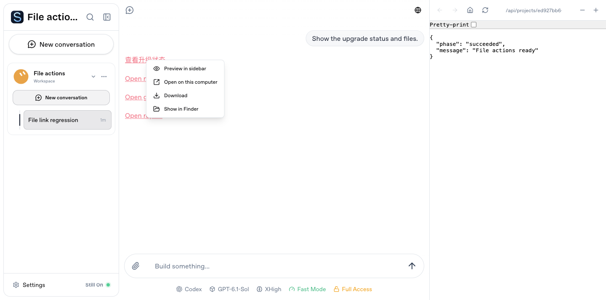

# Opening files

Click HTML, Markdown, JSON or text links inside a workspace to preview them in the right sidebar. The same preview works locally and remotely.

File menus offer:

- **Preview in sidebar**, for supported files.
- **Open on this computer**, during local access, using the operating system's default application.
- **Download**, through the currently connected computer.
- **Show in Finder / Show in folder**, during local access.

Files such as office documents that cannot be previewed open with the system application locally and download remotely. The preview toolbar follows the same rule for files; web pages keep their external/fullscreen action.

Settings no longer asks users to select an editor or enter an executable template. The keybindings file opens locally and downloads remotely. Saved editor choices are retired without changing other preferences. Older clients' editor actions resolve to system opening; external clients cannot launch applications on the Agent computer.

