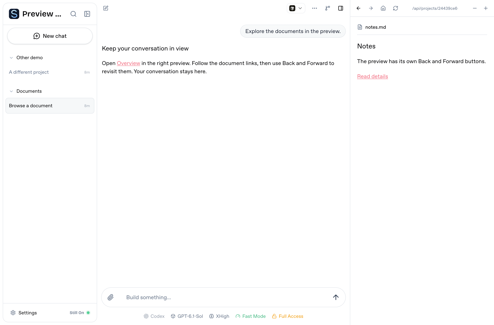

# Preview navigation

Use **Back** and **Forward** in the right preview toolbar to revisit documents
opened through Markdown links or the panel address field. These controls use the
current project's preview history and keep the StillOn conversation open.
Unavailable directions are disabled. Refresh keeps the current history entry;
opening a new address after Back replaces the forward branch.

**Home** opens the local-server launcher, where history controls are disabled.
Each project retains its own preview history when the pane is closed and reopened.
Native HTML file frames report validated document links and location changes.
Markdown body links share file/service actions; ordinary external links open in
the visiting browser. Text/image panels preserve their logical file target.
The service compatibility browser reports ordinary navigation, SPA history changes
and fragments to the panel. Open standalone uses the current reported address.
Refresh makes a GET request and never replays a submitted POST form.

File frames accept navigation messages only from the active iframe's isolated
origin/window and paths in its authorized directory. A frame cannot turn the
parent into a fetcher for arbitrary management URLs. Explicit document navigation
shows a loading state rather than leave the previous file interactive. Location
reports update the logical address without resetting the native document. Files
are reread on explicit refresh; backend POST retry semantics belong to services.
