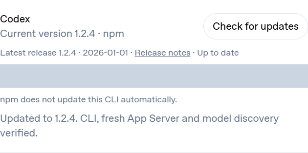

# Provider CLI updates

Settings → Providers → CLI updates shows the executable StillOn actually
selects, its current version, and the publisher's latest non-preview GitHub
release with its publication date and release notes. Opening the page or
checking releases does not install anything. There is no recommended version
feed, automatic upgrade, downgrade, or separate StillOn CLI distribution.

Click **Update to VERSION** to update the existing installation. Supported
methods are recognized global npm installations and official native
installations at their standard launcher locations. npm preserves the detected
global prefix; native installers receive the exact displayed version. Node.js
and npm must remain available for npm installations. Homebrew, Winget, Bun,
custom copies and ambiguous installations show an explanation and installation
guide instead of attempting a replacement. App-managed components must be
updated through their app. This does not change executable discovery or prefer
an App-bundled CLI.

The CLI's own update behavior is reported separately. npm has no background
CLI updater. Native Claude enables background updates by default; StillOn
reports the visible channel or `DISABLE_AUTOUPDATER`, with a policy caveat.
Native Codex's auto-update selection is managed by its installer. Unknown state
is displayed as unknown. StillOn does not change these preferences.

Updates require idle agents, closed terminals and no running model discovery.
StillOn reserves the coordinator, blocks new agent launches and waits for old
Codex App Server processes to exit. It rechecks the selected path and exact
version after installation. Codex also starts a fresh metadata-only App Server,
performs `initialize` / `initialized` and `model/list`, and checks the reported
version against the CLI. No inference turn starts and saved model selections
are unchanged. Signed-out accounts, incompatible servers and mismatched
versions produce a verification failure even if installation completed.

Short-lived opaque consent is scoped to the inspected installation and release.
Selection changes invalidate it; concurrent updates and repeated POSTs cannot
invoke an installer twice. Browsers never receive raw installer output or
environment values. Failure messages contain only safe categories or numeric
exit codes. There is no automatic rollback or retry after an interrupted or
partial install: check the current version, repair with the original installer
if needed, and check again. Operation state is in memory; the installed version
is read afresh after restart. Shutdown waits for an in-progress update.

Local and authenticated managed Connect share the same endpoints and state.
Existing gateway ownership, origin checks, signed adapter ingress and local
password protections apply. Remote users cannot supply commands, executable
paths, versions, package names or download URLs.

## Validation

```sh
bun run check
bun run test
bun run audit
bun scripts/test-provider-cli-updates.ts
bun run prepare:connect-runtime --server
bun scripts/build-connect.ts
bun scripts/test-connect-provider-cli-updates.ts --cloud-package=dist/connect-service
```

Acceptance scripts use a synthetic npm prefix and installer. They launch real
CLI and App Server subprocesses but only edit fixture files; no real provider
package or account is used. Connect acceptance exercises a real login gateway,
two tunnels, adapters and servers: remote update → local read, local update →
remote read, reload, failure/retry, origin/account/host isolation and replay
rejection. The platform CI matrix runs local process acceptance; Connect CI
runs packaged cloud acceptance. Unit tests cover selection changes, active work,
concurrency, redaction, preview versions and native/npm/App path handling.

`bun scripts/test-provider-cli-updates.ts --browser` starts a bounded browser
fixture. This screenshot uses synthetic versions and masks the temporary path.


