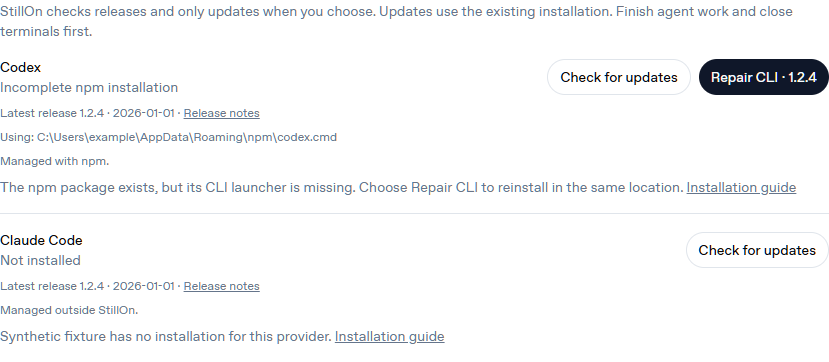

# Provider CLI updates

Settings → Providers → CLI updates shows the executable StillOn actually
selects, its current version, and the publisher's latest non-preview GitHub
release with its publication date and release notes. Opening the page or
checking releases does not install anything. There is no recommended version
feed, automatic upgrade, downgrade, or separate StillOn CLI distribution.

Click **Update to VERSION** to update the existing installation. Supported
methods are recognized global npm installations and official native
installations at their standard launcher locations. npm preserves the detected
global prefix; native installers receive the exact displayed version. Node.js
and npm must remain available for npm installations. Homebrew, Winget, Bun,
custom copies and ambiguous installations show an explanation and installation
guide instead of attempting a replacement. App-managed components must be
updated through their app. This does not change executable discovery or prefer
an App-bundled CLI.

The CLI's own update behavior is reported separately. npm itself does not
schedule CLI updates, but Claude's own updater also supports npm installations.
The effective Claude npm policy is reported as undetected, with that distinction
made explicit. Native Claude enables background updates by default; StillOn
reports the visible channel or `DISABLE_AUTOUPDATER`, with a policy caveat.
Native Codex's auto-update selection is managed by its installer. Unknown state
is displayed as unknown. StillOn does not change these preferences.
See [Claude's updater documentation](https://code.claude.com/docs/en/setup#auto-updates).

Updates require idle agents, closed terminals and no running model discovery.
StillOn reserves the coordinator, blocks new agent launches and waits for old
Codex App Server processes to exit. It rechecks the selected path and exact
version after installation. Codex also starts a fresh metadata-only App Server,
performs `initialize` / `initialized` and `model/list`, and checks the reported
version against the CLI. No inference turn starts and saved model selections
are unchanged. Signed-out accounts, incompatible servers and mismatched
versions produce a verification failure even if installation completed.

Short-lived opaque consent is scoped to the inspected installation and release.
Selection changes invalidate it; concurrent updates and repeated POSTs cannot
invoke an installer twice. Browsers never receive raw installer output or
environment values. Failure messages contain only safe categories or numeric
exit codes. Installer processes have no destructive wall-clock timeout or output
buffer limit: a large package must be allowed to finish writing and relinking
its launchers. Version probes and release/download requests remain bounded.
The UI shows elapsed time while installing or verifying. Shutdown waits for an
in-progress installer rather than killing it.

Before installation, StillOn atomically saves the consented provider, exact
version, original installation, phase, timestamps, attempt count and safe result
under `<dataDir>/cli-updates/codex.json` or `claude.json`. The installer PID is
recorded after spawn. These local records never contain the environment or raw
installer output, and the browser receives only the public operation status.
The most recent result remains visible after restarting StillOn.

An incomplete npm installation is retried once at the same prefix and exact
consented version, then verified. Startup can resume a pending consented update:
it reserves idle agents and waits for any surviving installer to exit before
checking the CLI. A completed target is verified without reinstalling. A missing
launcher/package can be reinstalled once, with a maximum of two installation
attempts per operation. A changed executable, explicit selection, working older
version or different version is not automatically overwritten. Native installer
failures require the original installer when the CLI remains broken.

Failed npm updates offer **Repair CLI · VERSION**, using new opaque consent for
the recorded target, including when release lookup is offline. Recognized npm
packages with unusable binaries also offer repair. Missing shims require the
configured global prefix, Windows' standard npm prefix, or a saved update record; an
unrecognized/custom/App-managed location never authorizes a replacement.
Checks alone do not run an installer. If a crash occurred before the installer
PID was saved, StillOn cannot safely determine whether it is still writing:
finish that installer, repair through the original installer, then restart
StillOn to verify the repaired target. It never launches a second installer in
that uncertain state. Recovery also keeps the existing agent/terminal idle gate.

Local and authenticated managed Connect share the same endpoints and state.
Existing gateway ownership, origin checks, signed adapter ingress and local
password protections apply. Remote users cannot supply commands, executable
paths, versions, package names or download URLs.

## Validation

```sh
bun run check
bun run test
bun run audit
bun scripts/test-provider-cli-updates.ts
```

Acceptance scripts use a synthetic npm prefix and installer. They launch real
CLI and App Server subprocesses but only edit fixture files; no real provider
package or account is used. Connect acceptance exercises a real login gateway,
two tunnels, adapters and servers: remote update → local read, local update →
remote read, reload, failure/retry, origin/account/host isolation and replay
rejection. The platform CI matrix runs local process acceptance; Connect CI
runs packaged cloud acceptance in the private service repository. Unit tests cover selection changes, active work,
concurrency, redaction, preview versions and native/npm/App path handling.
Recovery tests interrupt a real synthetic npm subprocess after it retires its
shim and manifest, terminate its StillOn parent, restart recovery and verify
that the shim and exact version are restored. Other checks cover surviving
installer PIDs, bounded retries, durable failures, offline repair consent,
unreadable/unwritable journals and installer output beyond the old buffer limit.

`bun scripts/test-provider-cli-updates.ts --browser` starts a bounded browser
fixture. This screenshot uses synthetic versions and masks the temporary path.


An incomplete npm installation offers repair in its existing prefix:


