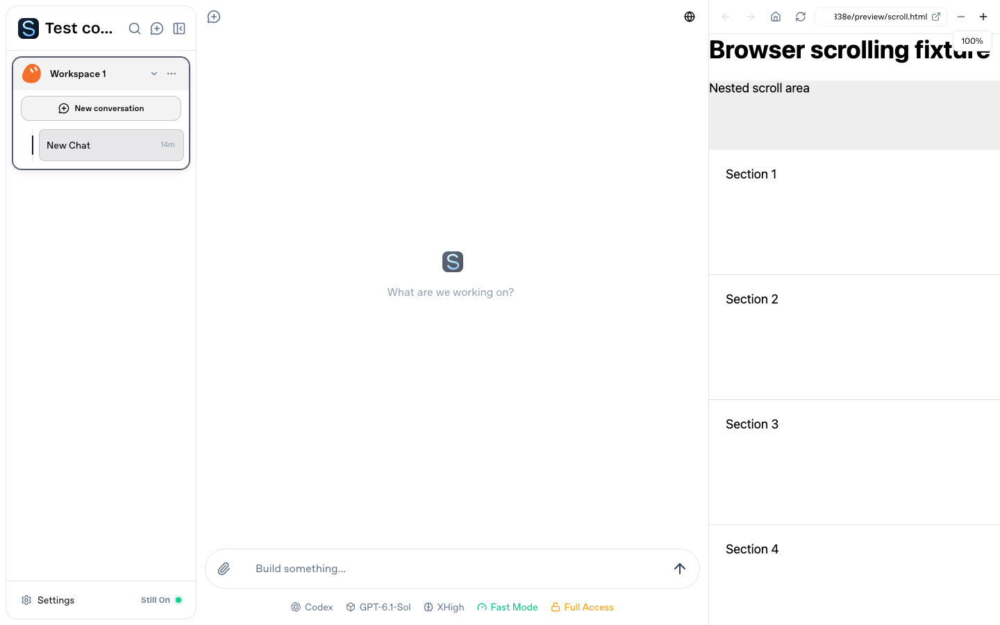

# Browser preview scrolling

At 50% zoom, the previous transformed iframe still contributed its original double-size layout box to an outer `overflow-auto` container. A 369×664 visible preview had a 738×1328 outer scrollable area. The iframe also scrolled independently, so the panel could display a scrollbar for a different scrolling surface.

The iframe now uses layout zoom and fills a non-scrolling wrapper as a block. Markdown uses the same layout-aware zoom within its own scroll container. Its fetch effect depends on the content URL and refresh version; hovering toolbar controls no longer reloads the same source and resets scrolling.

## Acceptance procedure

Use synthetic long HTML and Markdown documents, plus a local HTTP development app. Check both loopback and authenticated Connect entries. The Connect fixture must exercise the login gateway, real frps/frpc tunnel, adapter and StillOn server.

For each content type, check 50%, 90%, 100%, 130% and 200% zoom:

1. Scroll with wheel/trackpad input. The content moves and its outer wrapper stays at scroll position zero.
2. Drag the native scrollbar, then scroll to the bottom. The document end aligns with the viewport without a second scrollbar or a blank tail.
3. Scroll an embedded overflow area. Its contents move independently of the surrounding document.
4. In Markdown, scroll to the middle and move over and away from the zoom controls. The same source stays loaded and retains its scroll position.
5. Resize the panel and check the mobile overlay layout.

Native Safari gesture and scrollbar acceptance remains a manual check; Safari remote automation was disabled on the validation host. No Safari preferences were changed.
