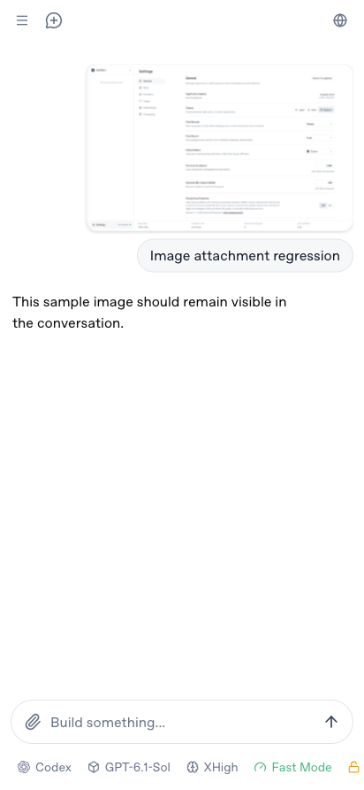

# Attachment image recovery

If an image request fails while Connect is recovering, the original thumbnail
stays broken even after connectivity returns. Opening its preview makes a new
request and can display the same file successfully.

Attachment thumbnails and modal images now retry after 0.5, 1.5 and 3 seconds,
using fresh request URLs that retain the original endpoint and parameters.
After exhausting those retries they show an unavailable placeholder. An `online` event
starts another bounded attempt. Changing the attachment or unmounting the
session cancels pending retries. Transcript thumbnails load lazily; composer
previews load immediately.

## Validation

- Reproduced the original broken-thumbnail/working-modal behavior by blocking
  the initial image request, then restoring connectivity in an isolated
  authenticated Connect workspace.
- Checked the repair at 412 × 892 through both local loopback and Connect,
  including the login gateway, frps/frpc tunnel, adapter and StillOn server.
  The thumbnail recovered without opening the modal; the modal also loaded.
- Chromium and Firefox regression checks cover transient HTTP failures,
  exhausted retry limits, online recovery, opening the modal, replacing the
  source and cancelling retries on session expiry.
- `bun run check`, `bun run test`, `bun run audit` and
  `bun scripts/test-connect-transport.ts` passed.

The browser regressions run in the existing CI browser job:

```sh
bun run test:remote-auth:browser
bun run test:remote-auth:browser --firefox
```


