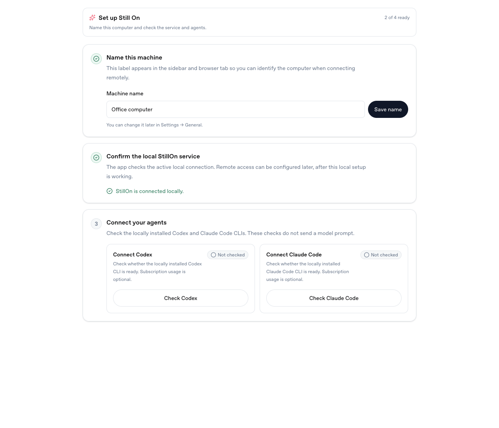
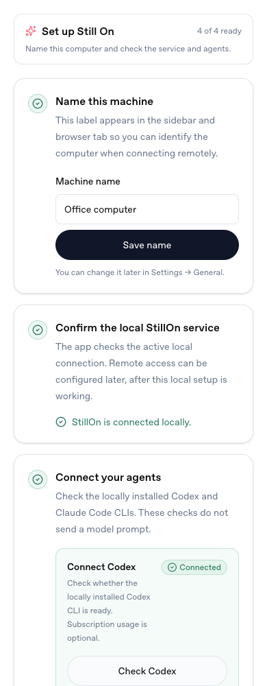
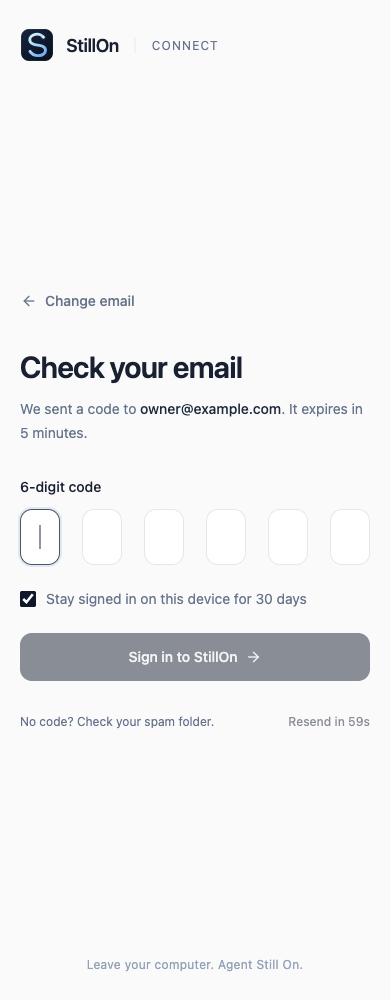
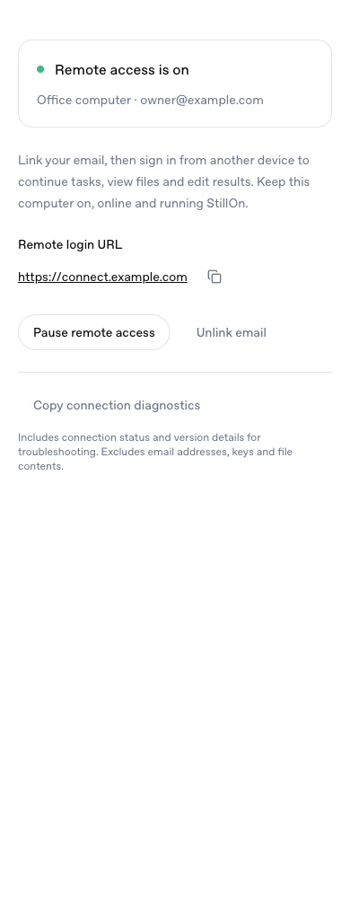

# Connect and setup UI review

Reviewed on 2026-10-16 with the actual React components and production-built styles. All screenshots use synthetic computer/account data; no production data, email delivery or model calls were used.

- Get started: compact two-line introduction, three numbered steps, four readiness checks. The header measured 74 CSS pixels at both 1280px and 390px widths. Existing name/provider completion remains valid; test messages are no longer required.
- Remote access: English local settings, linking, pause/resume, unlink confirmation, host selection, login, six-digit code entry and invalid-code guidance. No horizontal overflow at 390px in the reviewed screens.
- This UI review complements the repository tests. It does not certify all Connect deployment, platform or release acceptance gates.

| Desktop setup | Mobile setup |
| --- | --- |
|  |  |

| Email verification | Remote access settings |
| --- | --- |
|  |  |
