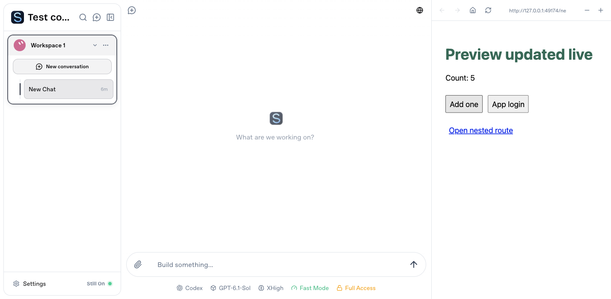
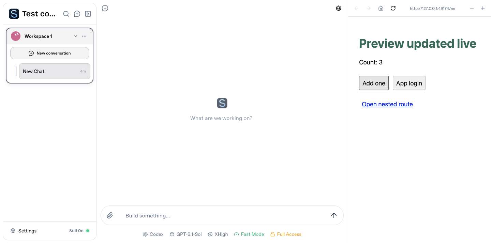
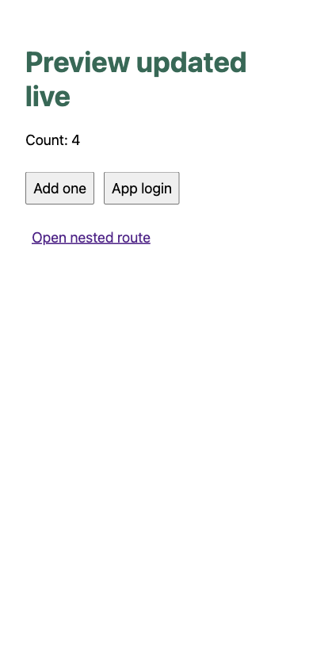

# Dynamic preview browser validation

Synthetic computers, workspace and application; no Agent calls or real mail.
The browser used the normal StillOn Browser panel against isolated local and
Connect gateways, with real frps/frpc and a Vite development server.

The local panel retained a direct loopback iframe and changed the API counter.

The Connect panel used an isolated preview origin, changed the same counter
and rendered a Vite hot update without reloading.

Open external produced an independent preview page. At a 390 px mobile
viewport it supported buttons, application login cookies and deep-route reload.

HTTP localhost aliases are separate browser sites. Iframe QA seeded the
generated preview cookie with SameSite=None; Secure; production retains
SameSite=Lax on sibling HTTPS origins. HTTP integration separately exercises
the authenticated one-use handoff and normal cookie attributes.
