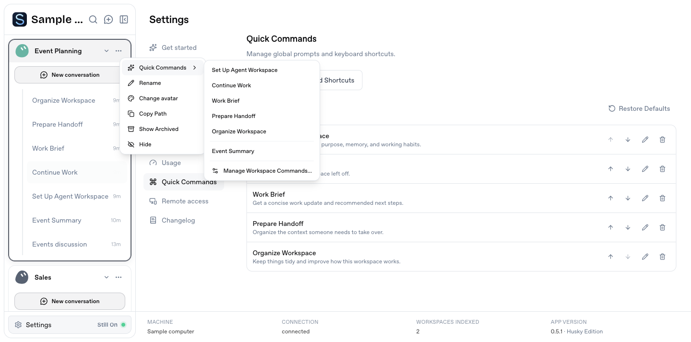
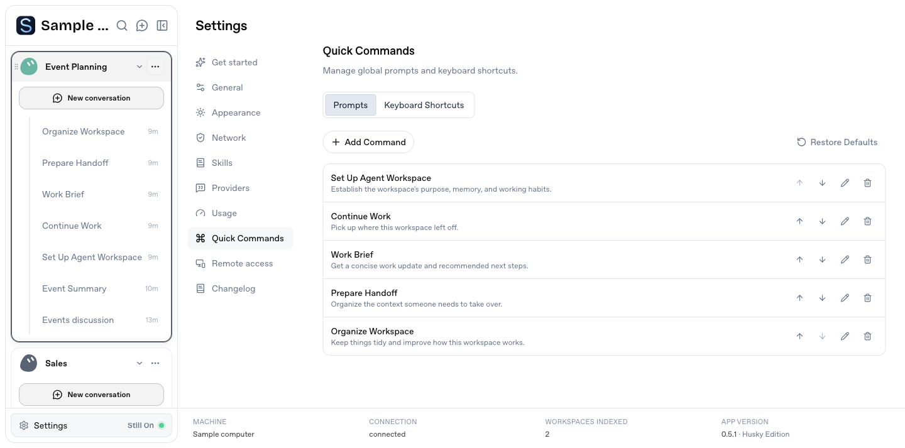
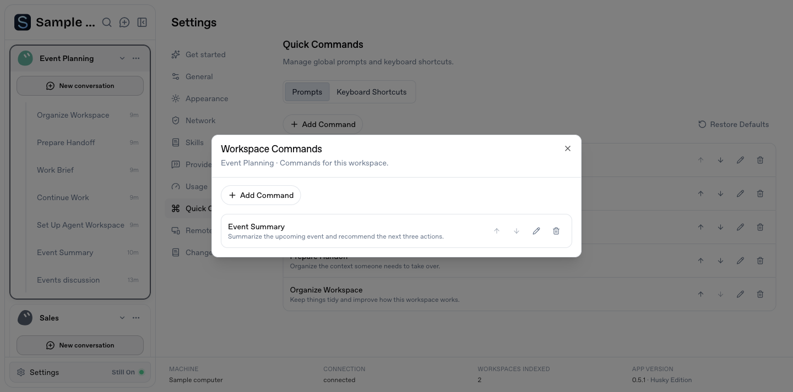
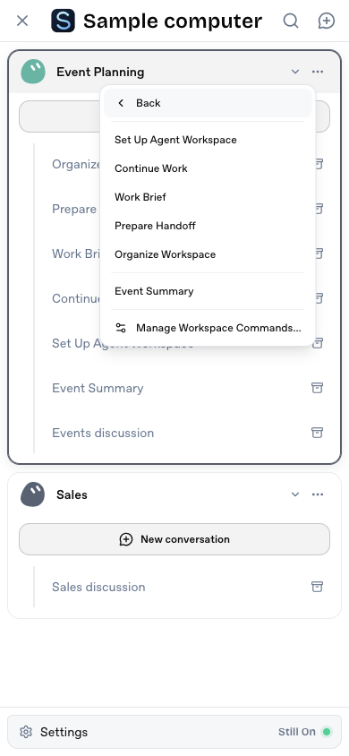

# Workspace Quick Commands

The workspace menu starts with **Quick Commands**, followed by Rename, Change avatar, Copy Path, Show Archived and Hide. Desktop menus open a submenu on hover or with the keyboard. On narrow screens, clicking Quick Commands opens its list inside the same floating menu, with a Back action so both levels remain usable within the viewport.

Global commands appear first, workspace commands follow a subtle separator, and **Manage Workspace Commands…** opens a workspace-specific editor. The editor supports adding, editing, removing and reordering commands. Settings → Quick Commands contains **Prompts** and **Keyboard Shortcuts**; existing `/settings/keybindings` links still open the shortcut controls. Saving a prompt never executes it.

The five editable defaults are Set Up Agent Workspace, Continue Work, Work Brief, Prepare Handoff and Organize Workspace. Work Brief requests a standalone HTML delivery. Setup and organization prompts preserve user files and storage habits, use root `agent.md` plus one support folder, and limit record updates to clearly agent-maintained material. These are editable prompt instructions and do not alter the selected agent's permissions.

Command definitions are persisted with the user's app settings, not inside business workspaces. Workspace commands use the stable workspace ID, so changing the sidebar name keeps them. Updates patch one scope at a time; serialized, atomic settings writes keep concurrent scope edits and existing settings intact.

Selecting a command captures the workspace, prompt and normal new-conversation preferences. A single request creates a separate conversation and sends its prompt as a visible user message, leaving the prior conversation and draft untouched. An unavailable agent leaves the new conversation and its prompt recoverable. Repeated clicks share the in-flight request. Remote acknowledgement loss checks the existing durable receipt; pending, unknown or missing receipts never authorize automatic replay.

## Validation

- `bun run check`, `bun run test`, `bun run audit`.
- Delivery tests cover repeated clicks, prompt snapshots, receipt recovery, delayed/missing receipts and confirmed unsent failures.
- Router tests verify the selected workspace, new conversation, original conversation preservation and unavailable-agent recovery without running a model.
- Settings tests cover separate scope edits, explicit deletions, reload persistence and existing setting preservation.
- Bounded Ego browser checks use synthetic business workspaces and the actual client/router/settings/event store with a stubbed agent: five default commands and one custom command each create their own conversation; drafts, scope isolation, workspace renames, management, reloads, shortcut values, desktop menus and a 390px click-open menu are checked.

The screenshots contain synthetic records and a generic machine name. The default prompts are not executed against real user files during validation.

