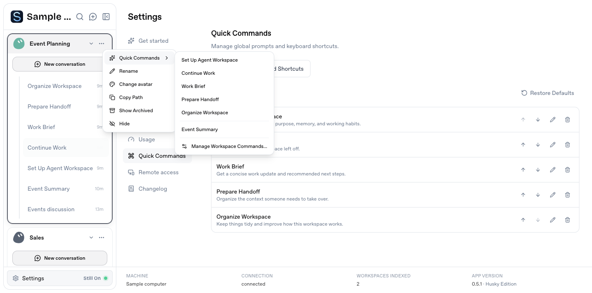
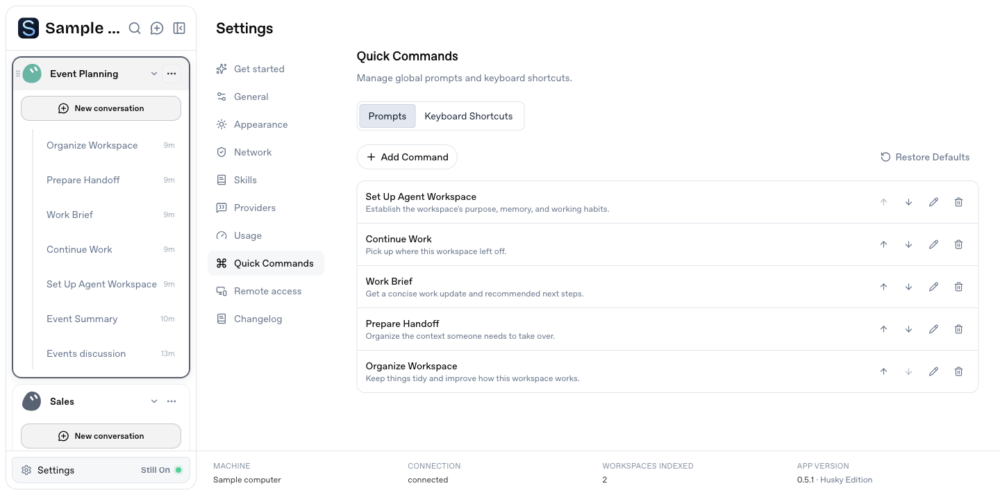
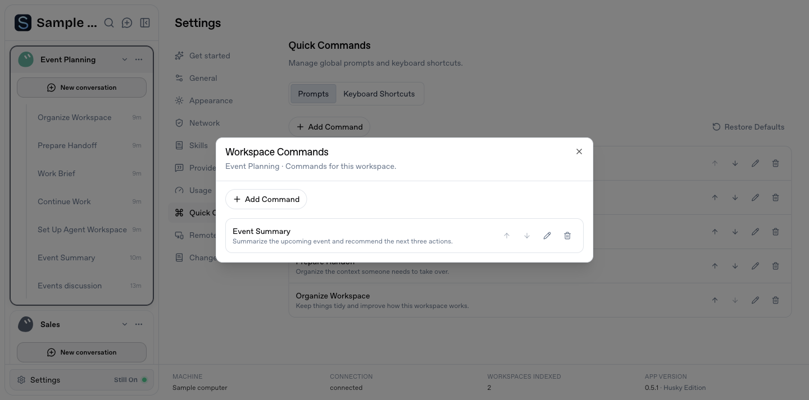
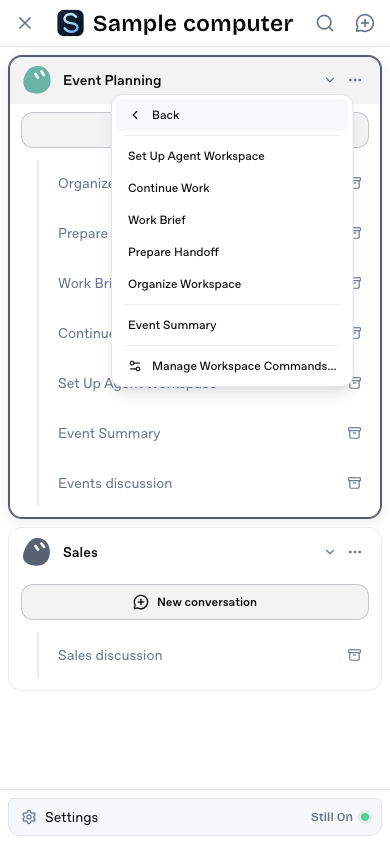

# Workspace Preset Prompts

The workspace menu starts with **Preset Prompts**, followed by Rename, Change avatar, Copy Path, Show Archived and Hide. Desktop menus open a submenu on hover or with the keyboard. On narrow screens, clicking Preset Prompts opens its list inside the same floating menu, with a Back action so both levels remain usable within the viewport.

Global commands appear first, workspace commands follow a subtle separator, and **Manage Workspace Prompts…** opens a workspace-specific editor. The editor supports adding, editing, removing and reordering commands. Settings → Skills & Prompts contains **Skills**, **Preset Prompts** and **Keyboard Shortcuts**; existing `/settings/keybindings` links still open the shortcut controls. Saving a prompt never executes it.

The three editable defaults are Organize Workspace, Prepare Handoff and Dreaming. Organize Workspace handles both first-time setup and later organization, inferring the appropriate scope without an upfront mode selection. Dreaming reads substantive source materials and compiles linked, source-backed topic pages while following existing user conventions. It establishes coverage for a new or shallow knowledge base, then incrementally maintains established knowledge and outstanding gaps. Root instruction, navigation, and status edits alone do not satisfy knowledge compilation. Set Up Agent Workspace, Continue Work and Work Brief are no longer defaults; existing saved copies remain editable user configuration. The canonical workspace entry is root `AGENTS.md`. Every default reads existing `Agent.md` / `agent.md` entries for context and reuses a legacy entry in place until migration is authorized, avoiding a second root entry or redirect. Organization describes recoverable entry migration and link updates under existing approval rules, reuses established support locations (falling back to `.agent/`), and limits direct updates to clearly agent-maintained material. These are editable prompt instructions and do not alter the selected agent's permissions.

Command definitions are persisted with the user's app settings, not inside business workspaces. Workspace commands use the stable workspace ID, so changing the sidebar name keeps them. Updates patch one scope at a time; serialized, atomic settings writes keep concurrent scope edits and existing settings intact.

On settings load, global built-in prompts with registered historical fingerprints are updated only when their ID and complete prompt SHA-256 match the shipped text. Names, descriptions, order, deletions, edited prompts, custom IDs and workspace-specific copies are preserved. Migration is persisted during settings initialization and is idempotent. It changes preset text; running a preset remains a separate user action, and no workspace files are renamed by the application. Users with customized prompts can edit them manually or choose Restore Defaults.

Selecting a command captures the workspace, prompt and normal new-conversation preferences. A single request creates a separate conversation and sends its prompt as a visible user message, leaving the prior conversation and draft untouched. An unavailable agent leaves the new conversation and its prompt recoverable. Repeated clicks share the in-flight request. Remote acknowledgement loss checks the existing durable receipt; pending, unknown or missing receipts never authorize automatic replay.

## Validation

- `bun run check`, `bun run test`, `bun run audit`.
- Delivery tests cover repeated clicks, prompt snapshots, receipt recovery, delayed/missing receipts and confirmed unsent failures.
- Router tests verify the selected workspace, new conversation, original conversation preservation and unavailable-agent recovery without running a model.
- Settings tests cover separate scope edits, explicit deletions, reload persistence and existing setting preservation.
- Legacy preset fixtures verify registered historical versions (including Organize Workspace and Dreaming from `1509a26`), single-character edit preservation, custom IDs, workspace copies, ordering, startup persistence and repeated loads.
- Bounded Ego browser checks use synthetic business workspaces and the actual client/router/settings/event store with a stubbed agent: the then-current five default commands and one custom command each created their own conversation; drafts, scope isolation, workspace renames, management, reloads, shortcut values, desktop menus and a 390px click-open menu are checked.

The screenshots contain synthetic records and a generic machine name. The default prompts are not executed against real user files during validation.

