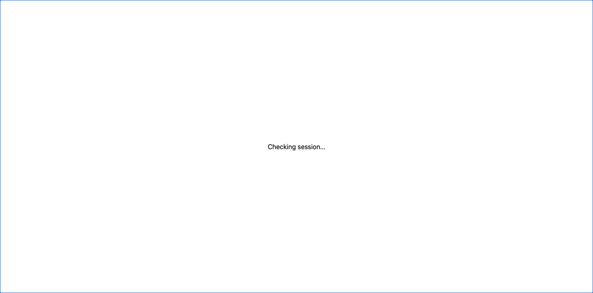

# Remote workspace revalidation

Returning to a remote browser window used to replace the workspace with the session checker and mount a new workspace after success. In the production-hook fixture, all five focus events discarded the unsent draft and reset scroll500→0, without a document navigation. The retained session boundary preserves the mounted workspace through revalidation; all five equivalent fixed cases retain draft, scroll and mount identity.

Routine window focus now checks the session in the background and coalesces overlapping focus/pageshow requests, preserving the visible workspace while the check succeeds. Pagehide/restoration and explicit session invalidation still use the native modal. Failed checks remain fail-closed.

The native modal sits above portaled UI and blocks interaction during protected checks. Its full-screen, opaque styling also works before application CSS loads. Cancel handling, `closedby=none`, Escape suppression and the close guard keep revalidation non-dismissible. Failed checks remain shielded; confirmed expiry/offline results unmount private content. A new successful session does not recover the expired session's private view. This does not enable persistent remote browser caching.

The screenshot is an isolated fixture using the real session boundary, without a real account, workspace or chat.

Reproduce with `bun run test:remote-auth:browser` and `bun run test:remote-auth:browser --firefox` after installing the corresponding Playwright browsers. The runner uses the production auth hook and session boundary against synthetic auth responses. It covers background focus revalidation and request coalescing, socket recheck, pagehide/pageshow handlers, failed requests, modal/portal isolation, expiry, new sessions, late-response fencing and unavailable hosts. The browser CI job runs both Chromium and Firefox. These are lifecycle-handler tests; they do not claim an automated Windows taskbar minimize test.
