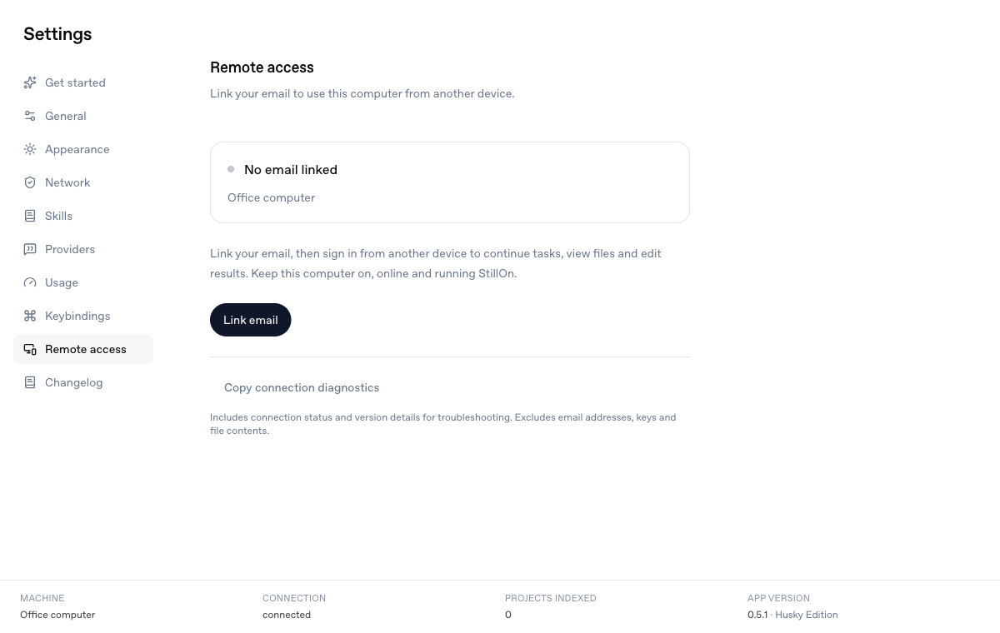
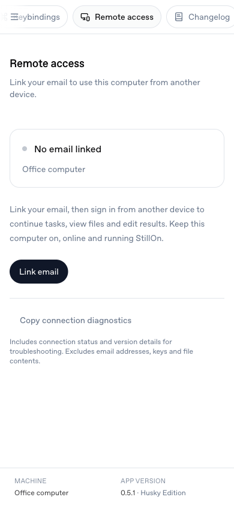

# Settings navigation

The shared desktop and mobile navigation uses MonitorSmartphone for Remote access and ShieldCheck for the host's VPN/network settings. Remote access sits immediately before Changelog.

Browser inspection uses the production SettingsPage with synthetic machine and connection data. Both entries open their existing routes on desktop (1200 × 760) and mobile (390 × 844). The mobile document has no horizontal overflow; its navigation scrolls horizontally.

