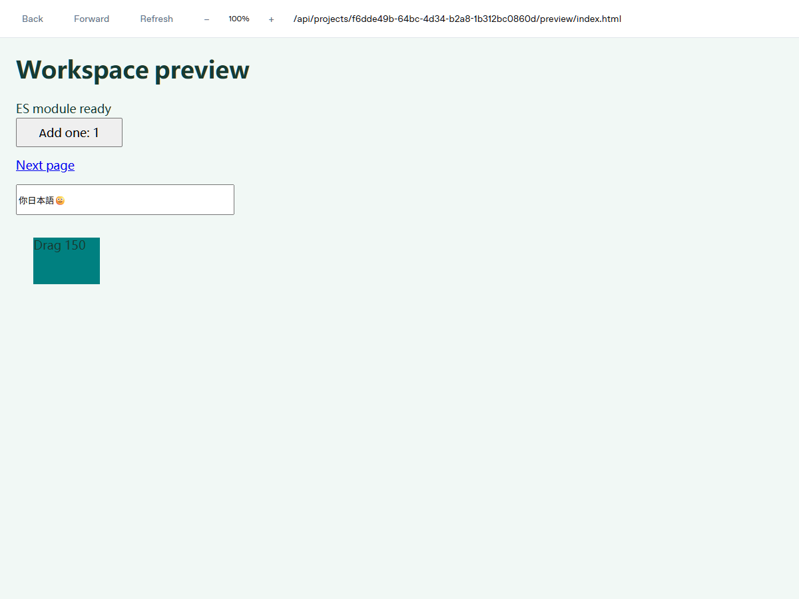
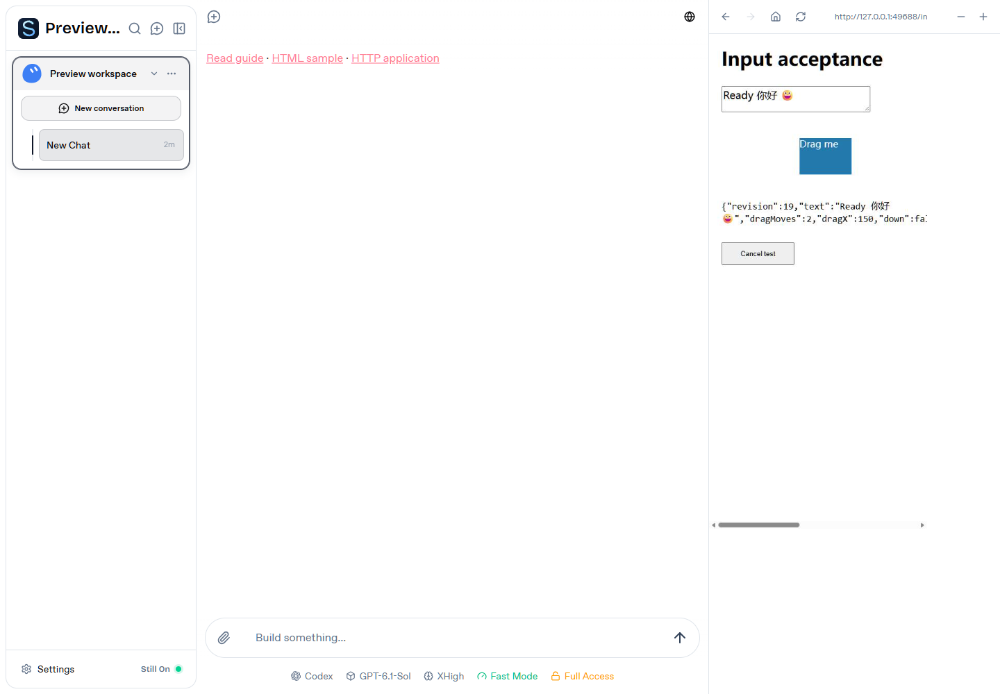
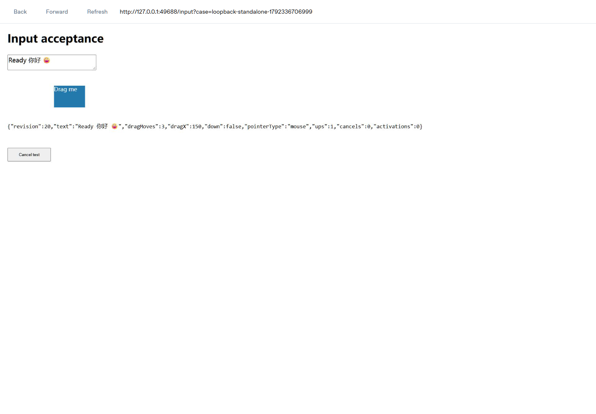
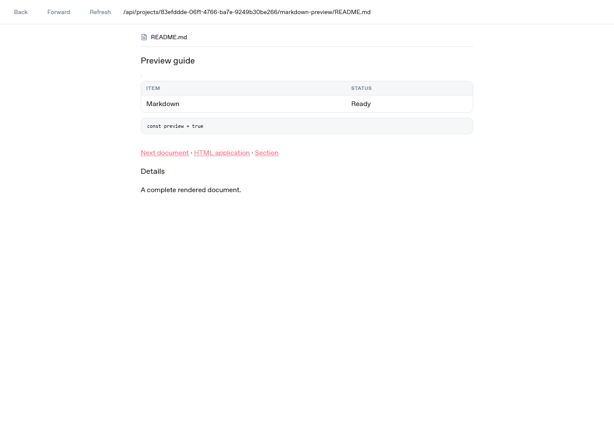
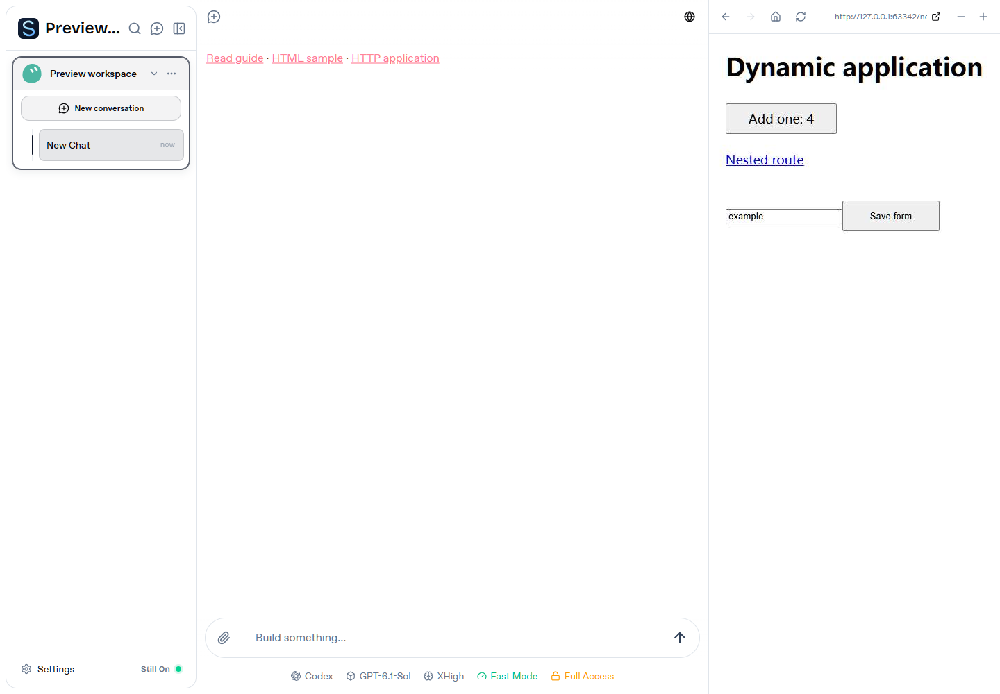
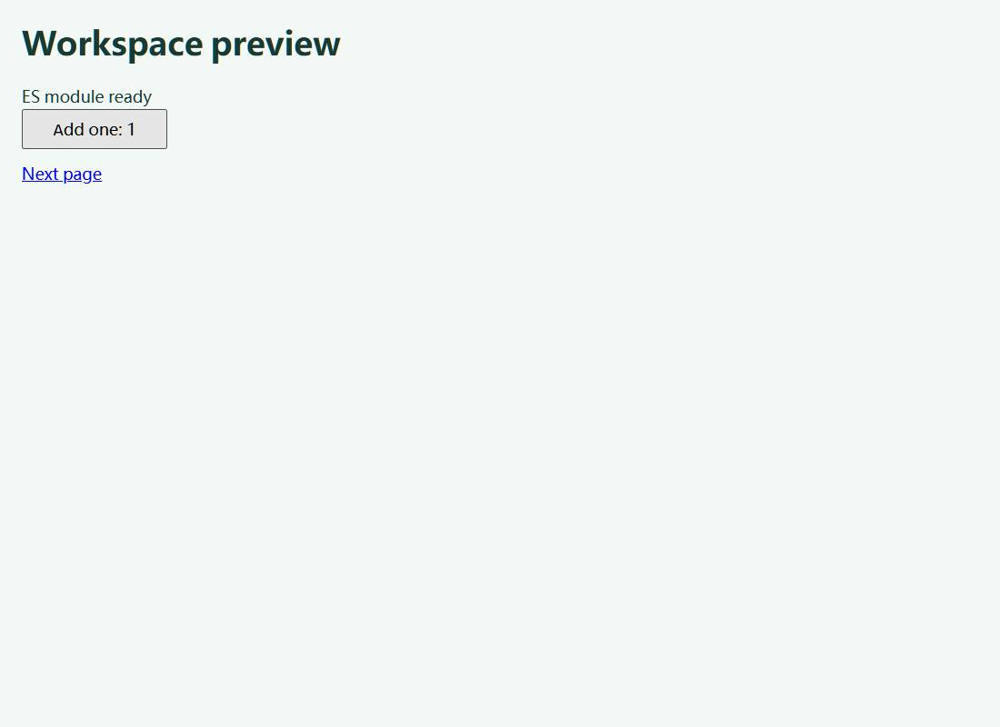

# Workspace preview validation

Workspace Git management has been removed. The Git file-item entries below
describe the earlier V2 candidate and are no longer part of current acceptance.
Chat, Markdown links and browser previews remain supported.

## V2 candidate (2026-10-19)

Implementation starts at `64de04c`; the UI/file-navigation implementation is
`6f57ddb`, followed by the native relay compatibility change described below.
The image-path handoff SHA-256 is
`65acb8991372d5f73076f34d9f58fffc734a6053c0dd5f6f0c4b554c9ad90820`.
The exact tested client/server/adapter/gateway source revision, dirty flag,
browser version and host OS are recorded in each generated result. The final
checkout builds and supported-platform results are linked from
[PR #225](https://github.com/bzbj/stillon/pull/225).

Source development and source-fixture testing are separate from final product
acceptance. The installed Windows application stays at 0.6.2 / `0b695e9daff2`;
the deployed production gateway revision is unknown. No release, gateway
deployment, host upgrade, managed metadata edit or startup change was performed.
Full product acceptance is **NotRun**: second-device Connect, physical OS input
methods, mobile and macOS Finder still have required work below.



### Commands and evidence scope

| Command/check | Local result | Evidence |
| --- | --- | --- |
| `bun install --frozen-lockfile` | Pass, exit 0 | Unchanged lockfile/dependencies |
| `bun run check` | Pass, exit 0 | Type check; client, export viewer and Connect builds |
| Focused changed-file, relay and sidebar-store tests | Pass, 117 tests | Canonical files/junctions, restart persistence, owner isolation, ingress, protocol, paths, policy, existing images and native stream cancellation |
| `bun run audit` | Pass, exit 0 | Repository audit command with its existing advisory exception |
| `bun run test` | Fail, exit 1 | 1,452 pass, 14 skip, 12 permission failures before the final navigation follow-ups |
| Unchanged-baseline permission subset | Fail, exit 1 | Same 12 failures: 11 symlink `EPERM`, one long PowerShell spawn `EPERM` |
| Edge file-only browser fixture | Pass, exit 0 | Unavailable host browser, zero browser-engine requests, eight file cells in both views |
| Full local Edge/Firefox browser fixtures | Pass, exit 0 each | Edge 155.0.4283.62 and Firefox 153.0; implementation `6f57ddb`, clean checkout, before the relay-only follow-up |
| Native relay cancellation/streaming/revocation | Pass, five consecutive Windows runs | 600 requests from 20 concurrent clients per run; exact bytes, incremental output, active-body revocation and stream cleanup |
| `bun scripts/verify-preview-discovery.ts --scans=30` | Pass, exit 0 | All 30 fresh Windows scans find the IPv4 and IPv6 fixtures |
| `bun run prepare:connect-runtime --server` | Blocked, exit 1 | Windows security software removes the checksum-verified official frp archive before extraction; no exclusions were added |
| `bun scripts/test-connect-dynamic-preview.ts` on this Windows host | Blocked, exit 1 | Required native frp binaries are unavailable |
| Real-frp Connect source integration | See final CI | Authenticated gateway -> tunnel -> adapter -> host, synthetic OTP delivery, one CI machine |

The full local repository result is not a passing suite. The 12 failures reproduce
in the unchanged #224 worktree; the affected files are unchanged from the base.
The supported-platform CI suite must pass for the final PR revision before merge.

Reproduce the browser checks after `bun run check`:

```sh
bun run test:previews:browser --local-only
bun run test:previews:browser --local-only --firefox
bun run test:previews:browser --local-only --files-only
bun run prepare:connect-runtime --server
bun scripts/test-connect-dynamic-preview.ts
bun run test:previews:browser
bun run test:previews:browser --firefox
```

Results live in `test-artifacts/workspace-previews/{chromium,firefox}/`, including
`api-results*.json`, `browser-results*.json`, original download sizes/MIME/SHA-256,
and generic screenshots. Engine results do not overwrite each other. Private
fixture JSON contains generated credentials and is excluded from artifact uploads.
Each browser also performs twenty cache-busted native module imports while cancelling
metadata requests, covering static asset integrity after navigation.
CI uses real frps/frpc, but its synthetic account and same-machine browser are not
a real second device or the deployed managed workspace.
Repeated standalone reloads are paced below the gateway's unchanged 1,200/minute
workspace limit; browser routing is removed after the controlled external tests.
This avoids turning the expanded matrix into an artificial uncached traffic burst.

A Linux Firefox CI attempt crashed its Bun 1.3.14 fixture in native uWS socket
close code during HTML recovery. A separate default async-stream abort probe also
crashes Bun 1.3.14 on Windows; Bun's [upstream report](https://github.com/oven-sh/bun/issues/32111)
documents a similar defect. The relay now uses Bun's native direct sink instead
of a default async-pull controller. It writes and flushes incrementally, awaits
backpressure and retains per-chunk authorization plus the one-second validity
timer. A child-process regression exercises cancellation, exact bytes, early
stream delivery and revocation. This is a compatibility workaround, not a Bun
upgrade or a claim that Bun itself is fixed. Final platform and authenticated
browser CI must pass on this relay revision before merge; the first crash log
remains part of the evidence.

Firefox also exposed an intermittent corrupt static-module response after a
navigation cancelled multiple requests. Private relay hops now use a separate
HTTP connection per exchange and reframe streamed bodies without carrying an
upstream Content-Length. Content-Encoding remains paired with the unchanged
compressed bytes; HEAD retains its representation length. The native regression
checks distinct upstream connections, gzip/Brotli byte integrity and HEAD
metadata alongside cancellation and a complete 1 MiB response. This trades
private-hop pooling for isolation under the pinned runtime; tunnel and visiting
browser connections keep their existing behavior.

One fresh Windows runner also exceeded the old ten-second PowerShell/.NET helper
watchdog on its first discovery scan; the next 29 scans passed. The helper now
has a twenty-second initialization allowance while each actual HTTP request
retains its 1.5-second deadline. Helper errors propagate instead of becoming a
cached empty service list. Final acceptance still requires 30/30 fresh scans;
there is no discarded warm-up scan or cached replacement for a failed scan.

### V2 preview matrix (36 cells)

Pass below is scoped to executed local source-fixture assertions. Connect source
integration is additional evidence; it does not fill either second-device column.

| Content | Local sidebar | Local standalone | Second-device Connect sidebar | Second-device Connect standalone |
| --- | --- | --- | --- | --- |
| Project Markdown | Pass | Pass | NotRun | NotRun |
| Authorized host Markdown | Pass | Pass | NotRun | NotRun |
| Project HTML | Pass | Pass | NotRun | NotRun |
| Authorized host HTML | Pass | Pass | NotRun | NotRun |
| Project text | Pass | Pass | NotRun | NotRun |
| Authorized host text | Pass | Pass | NotRun | NotRun |
| Project image path | Pass | Pass | NotRun | NotRun |
| Authorized host image path | Pass | Pass | NotRun | NotRun |
| Host HTTP service | Pass | Pass | NotRun | NotRun |

File checks cover native content, modules/classic JS, CSS/fonts/JSON/Canvas,
escaped text, images, independent URLs, reload, deletion/recovery and navigation.
HTML retains state during 80% zoom and resize, commits Chinese input to `你`,
accepts Japanese/emoji, and completes a native 150 CSS px drag. Nested HTML retains
the authorized package root across modifier/middle clicks, standalone reload and
registry restart. Native input is not a physical operating-system IME test.

PNG/JPEG/WebP/GIF/SVG/AVIF/APNG/BMP/ICO decode in both scopes and views; actual
GIF/APNG display frames change. SVG remains an image. Damaged, 25 MB and 40 MP
errors, retry, long-image aspect/zoom/scrolling and existing inline-image contracts
have source-fixture evidence. DOCX/PPTX use real synthetic Office documents,
participate in action/download checks, and are outside the preview matrix.

### Behavior/source ledger (22 groups)

This ledger records complete group acceptance, not just the shared policy unit
test. A partially automated group is NotRun; its remaining actions still need a
source-specific demonstration. All visible local Open/Show combinations and
second-device actions must be exercised before declaring B01–B08 fully accepted.

| Source | Row | Status | Executed evidence / remaining gate |
| --- | --- | --- | --- |
| Chat | B01 | Pass | Controlled external HTTP(S) `.html`/`.md`, original browser tab, native menu, zero external target/session registration |
| Chat | B02 | NotRun | Same-host Connect browser check in CI; second device outstanding |
| Chat | B03 | NotRun | Sidebar text/image, ordered menu, keyboard, modifier/middle; all source-specific OS actions outstanding |
| Chat | B04 | NotRun | CI sidebar and real browser downloads; second device outstanding |
| Chat | B05 | NotRun | Office menu; real API/OS launch evidence below; source-specific menu/default activation outstanding |
| Chat | B06 | NotRun | CI menu/default Office download hashes; second device outstanding |
| Chat | B07 | NotRun | Service sidebar/menu; original system-browser Open demonstration outstanding |
| Chat | B08 | NotRun | CI host service; second device outstanding |
| Markdown | B01 | Pass | Controlled external target and native menu; no preview/session registration |
| Markdown | B02 | NotRun | Same-host CI external target; second device outstanding |
| Markdown | B03 | NotRun | Relative HTML/image links and shared menu; all OS actions outstanding |
| Markdown | B04 | NotRun | CI relative files/download actions; second device outstanding |
| Markdown | B05 | NotRun | Office menu; source-specific OS activation outstanding |
| Markdown | B06 | NotRun | CI menu/default original Office download; second device outstanding |
| Markdown | B07 | NotRun | Service link/sidebar; system-browser Open outstanding |
| Markdown | B08 | NotRun | CI host service; second device outstanding |
| Git file item | B03 | NotRun | Markdown menu and image filename preview; all OS actions outstanding |
| Git file item | B04 | NotRun | CI rendered files and ordered actions; second device outstanding |
| Git file item | B05 | NotRun | Office menu; OS activation outstanding |
| Git file item | B06 | NotRun | CI menu/default original Office download; second device outstanding |
| Service list | B07 | NotRun | Sidebar and standalone; original system-browser Open outstanding |
| Service list | B08 | NotRun | CI host service; second device outstanding |

Windows OS evidence uses the real action API plus UI Automation/Explorer COM,
not a mocked spawn or an API 200 alone. Generated DOCX and PPTX appeared in Word
and PowerPoint (protected view). Explorer selected original synthetic TXT, PPTX
and HTML files. TXT/HTML default-app windows and the Word-file selection were not
observable in those probes and are Blocked evidence, not Pass. File associations
were left intact. This is representative OS-layer evidence, not completion of
every local source/menu combination or macOS Finder.

### Detailed coverage and remaining acceptance

| Cases | Source-fixture evidence | Remaining work |
| --- | --- | --- |
| L01–L07 | Native external opening, actual-href classification, loopback/IPv6, file URI/home/relative/Unicode/single-decode parsing, stable file menus | Physical host path/permission variants beyond the synthetic fixtures |
| L08–L10 | Shared B01–B08 unit policy; right-click, Escape, Shift+F10/Enter and opaque modifier/middle URLs; representative OS actions | Complete all 22 groups and every visible OS action |
| F11–F14 | Unavailable host browser; real document DOM/resources; native composition, Unicode and scaled mouse drag/resize | Physical OS IME and mobile input methods |
| F15 | Native DOM and scrollable document/image panels | Manual selection/copy/clipboard/animation review; no OS clipboard was modified by tests |
| F16–F17 | Markdown tables/code/images/relative navigation; escaped script-looking TXT | Full source/action permutations and large-text UI variants |
| F18 | Original MD/HTML/TXT/PNG/DOCX/PPTX hashes and UTF-8 names; CI browser menu/default downloads | Actual second-device download verification |
| F19 | Abort-aware download implementation; deletion/recovery and revoked target/session contracts | Browser cancellation, expired file grants, offline/reconnect download combinations |
| F20–F21 | Current opaque targets, nested HTML resource roots, history/reload, deleted-file restoration | Additional on-disk edits and OS permission-change UI cases |
| F22–F24 | Chat/Markdown/Git image paths; nine native formats; animated frames; aspect/zoom/scroll; damaged/oversize/pixel limits; inline-image regressions | Every outside-file source combination, transparency review, physical mobile, revocation/offline image UI combinations |
| D01–D05 | Explicit deep service admission; root 404/no title/slow root/401/403/500/IPv6; API/form exactly once/WS; stop/recovery; 30 fresh scans | Actual managed deployment revisions and device acceptance |
| D06–D08 | CI authentic transport, bidirectional backend counter, current service navigation/standalone | Separate HOST-A/VIEWER-B devices with the same port and cross-entry writes |
| D09–D10 | Retained #224 composition/paste/Space/pointer ownership/watchdog/capture/touch protocol regressions | Physical keyboards/touch; deployed host offline/reconnect/auth-expiry checks |
| S01–S03 | Owner-bound IDs, canonical paths, real junction denial, root persistence, SOP/cookie/storage/API isolation | Real distinct-account/device file acceptance beyond unit/source transport |
| S04–S06 | Repeated forged-local Open/Show denied over frp; protected ports; gateway session/pause/revocation and existing one-second relay cancellation contracts | Deployed file-stream revocation timings and service process replacement/device combinations |
| C01–C04 | Old target parsing, file reauthorization, explicit external browser card, protocol/adapter capability errors, existing attachment/settings/other repository regressions | Historical live-data UI review and all deployed old/new version combinations |

Record code, local acceptance, same-host integration, real remote acceptance,
merge, release and host upgrade independently. NotRun and Blocked are not passing
cells. The remaining physical/device steps require their own concrete evidence;
no production upgrade was performed to manufacture that evidence.

## Historical PR #223/#224 evidence

Everything below records the old implementation. Its external-website preview
matrix is obsolete under v2 and must not be used as current acceptance evidence.

Baseline: server/adapter/application 0.6.2, source `0b695e9`. The installed managed
application remains on this baseline. No release, deployment or local upgrade is
part of this PR. The public gateway health endpoint responds but does not report
its source version; that deployed version is **unknown**.

Implementation covers target resolution, shared document views, isolated web
browsing, directory capabilities, independent admission, navigation and recovery.
Implementation/review ownership and the final source revision are tracked in the PR.

## Reproduction and evidence

```sh
bun run check
bun run test
bun run audit
bun run test:previews:browser --local-only --external-sites

# Full authenticated integration, with verified native transport binaries:
bun run prepare:connect-runtime --server
bun scripts/test-connect-dynamic-preview.ts
bun run test:previews:browser
bun run test:previews:browser --firefox
```

Windows local browser: Edge/Chromium 155. Fixtures use synthetic documents,
accounts and machine names, never start an Agent and never send email.
Generated evidence is under `test-artifacts/workspace-previews/`. API assertions
record modules, resources, actual input, storage, exactly-once form submission,
WebSocket echo, deep routes, bidirectional backend writes and blocked control ports.
Browser assertions record sidebar/standalone rendering, relative images, real
button writes, modifier/middle clicks, native context menus and refresh.
Transient frame timeouts are retried with GET only; already-applied input is
never replayed by the acceptance fixture.

Only result summaries and generic screenshots may be uploaded. Private fixture
JSON includes generated test credentials and must remain private.

## Follow-up to the independent PR #223 acceptance

The independent review found duplicated IME commits, missing drag presses/releases,
and intermittent Windows service-list omissions. Those findings supersede a blanket
claim that the earlier browser matrix covered all interactive applications.

Composition now remains in the visiting textarea until committed. Ordered input
delivery preserves text/key/pointer order over Connect; long pastes preserve emoji
across request boundaries. Native Chromium IME dispatch checks Chinese and Japanese
in the direct application, sidebar and independent page. Firefox checks its
composition event lifecycle explicitly; that is not native IME evidence.
Native keys activate the target's private tab before dispatch; a cross-tab
Space assertion covers background key loss.
Paste-event tests leave both operating system clipboards untouched. Real OS input
methods and physical touch keyboards still require device acceptance.

Mouse and touch now transmit press, movement, release and cancellation, with scaled
coordinates and visiting pointer capture. Viewer release, navigation and a
five-second lost-pointer watchdog release held input without activating a button.
Only a foreground view reporting the held pointer renews that press; background
session heartbeats cannot keep it stuck. Browser tests exercise scaled mouse/touch
drags and capture/touch cancellation. API assertions exercise viewer ownership,
background heartbeat/watchdog behavior, release and stale queued-input rejection.

Discovery connects to actual loopback addresses while preserving localhost Host
semantics. Windows batches metadata through the system HTTP client in a hidden,
profile-free PowerShell process: Bun's HTTP client ignores socket overrides here,
and raw refused-connection probes exposed native Windows Bun crashes. The Windows
probe has a 1.5-second per-port response budget, excluding process/compiler startup,
bounded metadata, cancellation, no cookies/proxy and same-port loopback redirects.
Unix uses bounded direct sockets. Discovery cache lifetime is five seconds; the
separate process-identity authorization checks retain no discovery TTL.

```sh
bun scripts/verify-preview-discovery.ts --scans=30
bun run test:previews:browser --local-only
bun run test:previews:browser --local-only --firefox
```

The discovery script records each fresh scan and both families. CI includes an
additional Windows Edge/discovery job and retains separate Chromium/Firefox
browser summaries so one engine cannot overwrite the other's IME evidence.
One Windows x64 stress run, alongside the repository suite and browser checks,
found both listeners in all 30 fresh scans. Cold scans took 3.85–7.14 seconds in
that busy sample, including process/compiler startup; these are observations,
not a latency guarantee. The focused preview run recorded 47 passes and three
Unix-only skips, with the Windows native batch exercised instead.
These are source-fixture checks. Deployment, a real second device, production
Connect and physical input methods remain outstanding acceptance gates below.




The Windows type/build checks, audit and focused preview regressions pass.
The latest full local run recorded 1,441 passes, 14 skips and 13 failures, with
two hook/test errors: 11 existing `EPERM` symlink failures and two migration
timeouts during concurrent validation. The unchanged PR #223 baseline reran all
six migration cases successfully in isolation, including those two cases. The
symlink failures also reproduce in the clean baseline. This is **not** a passing
full-suite result. The PR's full supported-platform CI matrix must pass before merge.

Windows Defender blocks extraction of the checksum-verified official frp test
package here. No security exclusions or policy changes were made. CI runs real
frps/frpc, authenticated gateway, adapter and StillOn hosts on Linux. That is
integration evidence on one test machine, not second-device production acceptance.

## Matrix

Pass means an executed local assertion; Blocked does not mean Pass. The Connect
integration has a separate CI record and cannot replace second-device acceptance.

| Content | Local sidebar | Local standalone | Second-device Connect sidebar | Second-device Connect standalone |
| --- | --- | --- | --- | --- |
| Project Markdown | Pass | Pass | Blocked | Blocked |
| External Markdown | Pass | Pass | Blocked | Blocked |
| Project HTML application | Pass | Pass | Blocked | Blocked |
| External HTML application | Pass | Pass | Blocked | Blocked |
| Host HTTP application | Pass | Pass | Blocked | Blocked |
| External HTTPS content | Pass | Pass | Blocked | Blocked |
| XFO-restricted content | Pass (controlled app) | Pass | Blocked | Blocked |
| CSP-restricted content | Pass (controlled app) | Pass | Blocked | Blocked |
| External HTTP content | Pass | Pass | Blocked | Blocked |

The controlled app sets both `X-Frame-Options: DENY` and
`frame-ancestors 'none'`. Its actual sidebar button/form still writes to the
backend: it is rendered in a browser rather than a third-party iframe.
Public HTTPS and HTTP samples are optional network-dependent smoke checks.

## Plan checklist ledger

These statuses describe local/automated evidence. Production-gateway and
second-device portions remain blocked pending authorized test access.

| IDs | Evidence or remaining gate |
| --- | --- |
| A01 | Chat document/HTTP routing, real sidebar API button write |
| A02 | Shared renderer and Markdown/address checks; file-list and service-list local browser checks, plus authenticated Connect CI assertions |
| A03 | Modifier/middle click and native-context-menu checks |
| A04 | Workspace/history isolation regressions; multi-device exercise pending |
| A05–A06 | Markdown formatting, relative images/documents, anchors and shared renderer |
| A07 | Direct access/reload and persisted opaque registry restart regression; production re-login pending |
| A08 | Classic/module scripts, CSS, image/font, JSON fetch, actual counter button |
| A09 | Blocked: external HTML through the deployed production Connect version |
| A10 | Bounded file-app storage/fetch and real HTTP backend writes; no implicit backend execution |
| A11–A12 | Titleless, root 404 and 900 ms root variants admit the actual application path |
| A13–A14 | Loopback IPv4/IPv6/encoding/query/fragment regressions; public IPv6-only plain HTTP is explicitly unsupported and cannot substitute a local destination |
| A15 | Actual API, native form, WebSocket echo; refresh does not replay POST |
| A16 | Resource/redirect policy regressions and transport integration; production check pending |
| A17 | Gap: arbitrary absolute localhost URLs and multi-port backends are not automatically remapped |
| A18–A19 | Current deep path/query/fragment and SPA replace/pop store checks; production navigation pending |
| A20 | Active-session storage, standalone reuse and reload; expiry/reclamation is documented |
| A21 | Local backend writes/reads; cross-entry writes in Connect CI, final remote acceptance pending |
| A22 | Blocked: second-device wrong-host marker was not supplied |
| A23–A25 | Stopped service restart retains the deep target and recovers immediately; 401/403/500 remain app responses; production offline rehearsal pending |
| A26 | Controlled framing restrictions and public-site smoke; remote HTTP-only device check pending |
| A27 | Session reuse, viewer release, quotas and cleanup; prolonged lifecycle review remains separate |
| S01–S02 | Owner-bound IDs and account/host gateway regressions; production multi-device check pending |
| S03 | Directory/hidden-file/escaping-link checks; Windows link privilege limits the local suite |
| S04–S05 | Unsafe protocols, credentials, private/mapped IPs, control ports, header stripping, legacy-link origin isolation and host clipboard denial |
| S06 | Gateway resource revocation and transport logout/pause CI; isolated browsers inherit the signed parent lease expiry, with a real live-WebSocket closure assertion; production browser-session check pending |
| S07 | Origin/address/control-port checks and listener PID/start-time pinning; a real process replacement on the same port is denied until explicit reauthorization |
| C01 | Existing store migration retained, targets persist, expired IDs show recovery guidance; saved localhost file links migrate only from the current local StillOn port or reserved 3210, and custom remote ports require reopening the file |
| C02 | Generic HTTP forwarding retained; old adapter session headers fail closed; deployed version combinations pending |

## Deployment and outstanding acceptance

Update the gateway for legacy project-external static capabilities, then deploy
the host/adapter/client through normal managed releases. The host needs installed
Chromium. Roll back with existing managed recovery; do not edit ownership metadata.

Final acceptance is **not complete** until an authorized second device checks the
candidate through the real login gateway, tunnel, adapter and host, including the
wrong-host marker, persistence, revocation, offline recovery and version matrix.
PR merge is independent from acceptance, release and local upgrade.




