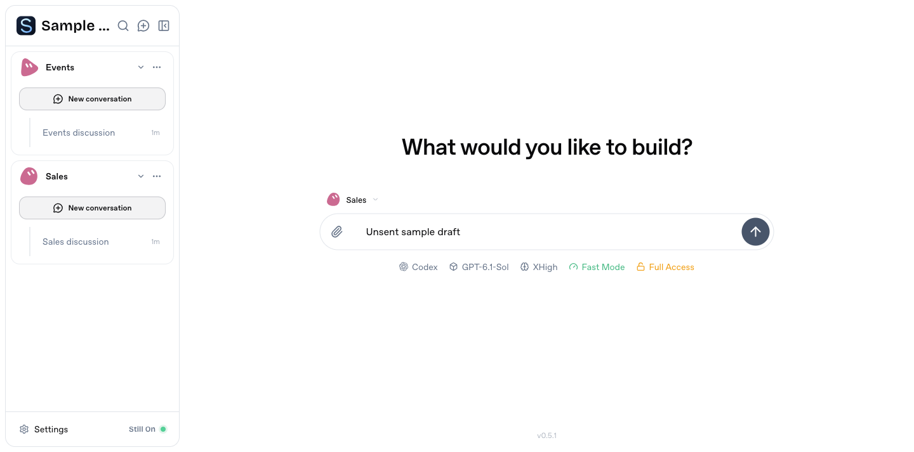

# Workspace selection without an open conversation

On the home composer, sidebar hydration previously marked the first workspace as current even when the composer used a different saved default. Returning home could also retain the previous conversation's workspace highlight.

The sidebar now marks only the workspace belonging to the open conversation. Home and Settings show no current workspace. The home composer's workspace picker and saved default remain independent. A newly created conversation can use its captured workspace while its matching subscriptions load; an unrelated conversation cannot inherit that pending selection.

Validated with the real client and an isolated server: initial home, compose target/default changes, switching between two conversations, returning home and Settings. Model execution was disabled. State regressions also cover stale state, unloaded sidebar data and pending conversation identity.

