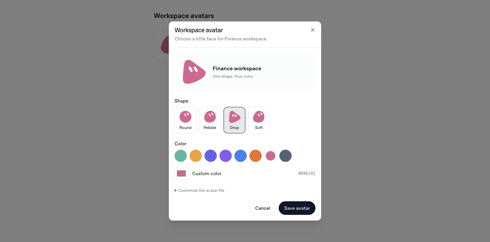
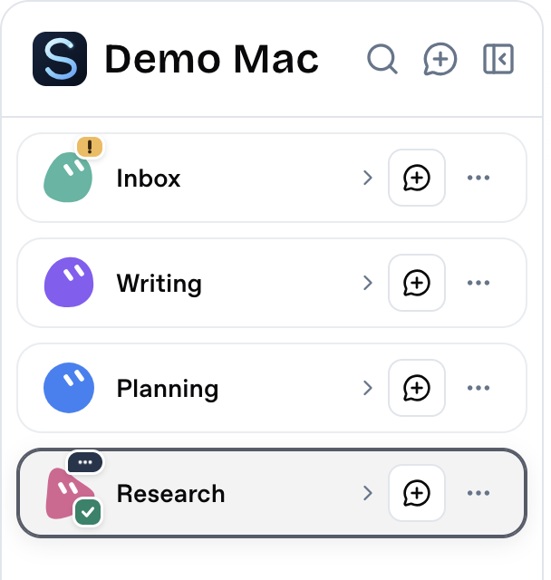

# Workspace avatars

Use a workspace's menu → **Change avatar** to choose a shape and a single body
color. The avatar belongs to the workspace ID, so renaming the folder or
switching Agent providers keeps the same face.



The UI reads and writes the host computer's
`~/.stillon/data/customizations/appearance/avatars.json`. Custom data directories
use the same `customizations/appearance/avatars.json` path below their data root.
This file contains the shape library, color palette and workspace choices. It
is created only when missing, preserved across upgrades, and shared with remote
Connect clients. There is no browser-only copy to keep in sync.

To customize it, edit the JSON and choose **Reload from file** in the avatar
dialog, or return focus to StillOn. Shape IDs are stable lowercase names;
`body` and `eyes` are SVG path data in a 64×64 view box. Each body has one fill,
and the eye marks are white. `eyeWidth` controls their stroke width. Palette
and choice colors use six-digit hex values. Add definitions to `shapes`, hex
colors to `palette`, and ID-to-choice mappings to `workspaces`.

The file accepts vector data, without executable SVG markup or external image
URLs. Invalid edits leave the last good appearance visible and must be fixed
before saving from the dialog. Safe mode renders built-in avatar definitions.

## Selection and activity



Cards use a compact, single-line name with a 32px avatar, without a second
Workspace subtitle. State descriptions remain available to assistive technology
and in the hover tooltip. The current Workspace has a double outline even when its conversations are
folded. The outline follows the selected Workspace; folding the card does not
change selection or mark results as read.

A small speech tab on the avatar's top right shows **…** while any conversation
is starting, running or stopping. A check on the bottom right means a completed
conversation has a new result to read. Both can appear when another conversation
is still working. Reading all new results clears the check. Input requests and
unread failures use an attention mark rather than a completion check.

Status colors and glyphs use the same user-owned `avatars.json` file. Optional
`statusBadges` has `working`, `complete` and `attention` entries. Each accepts
`background` and `foreground` as six-digit hex colors, and `mark` as SVG path
data in a 16×16 view box. Existing files without this block keep working and
use built-in defaults. For example, a complete `statusBadges` block is:

```json
{
  "working": { "background": "#24344b", "foreground": "#ffffff", "mark": "M4 8h0.01M8 8h0.01M12 8h0.01" },
  "complete": { "background": "#168368", "foreground": "#ffffff", "mark": "M4 8l3 3 5-6" },
  "attention": { "background": "#f2bb54", "foreground": "#39270c", "mark": "M8 4v5M8 12h0.01" }
}
```

Reload from the avatar dialog or return focus to StillOn after editing. Avatar
choices preserve these custom marks and colors. Working animation respects the
system's reduced-motion preference. Activity comes from conversation state and
is not saved as a visual preference.
